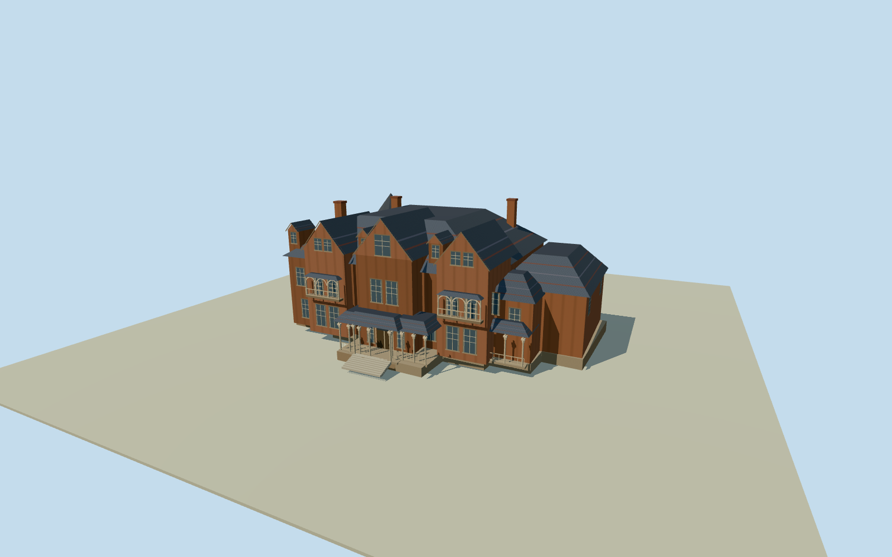

# North Carolina Executive Mansion

The Queen Anne Executive Mansion in Raleigh, with three brick front gables, multicolored slate, open timber galleries, a round turret, and marble entry stair.

Authoring state: **review-in-qa.json**. Current completion evidence is in [qa.json](qa.json) and the [completion ledger](../../../../qualla-structures/batches/qualla-003.PROGRESS.md).

- [North Carolina Executive Mansion](https://qualla.com/north-carolina-executive-mansion/)

This exterior represents the permanent architecture visible in October 2025. Seasonal decorations, street furnishings and interior spaces are outside the model.

The two east-facing photographs guide the west elevation. Roof heights and joins, east-facing windows and side roof forms are approximate.

The massing follows the mapped mansion and verandas. The sampled terrain is retained and individual steps and grades remain approximate.

Build: `node content/worldgen/source/places/dq/dq2/north_carolina_executive_mansion/models/generate-north-carolina-executive-mansion.mjs`. Add `--check` to verify exact regeneration. 2953 triangles; 5 materials; no embedded photographs.
