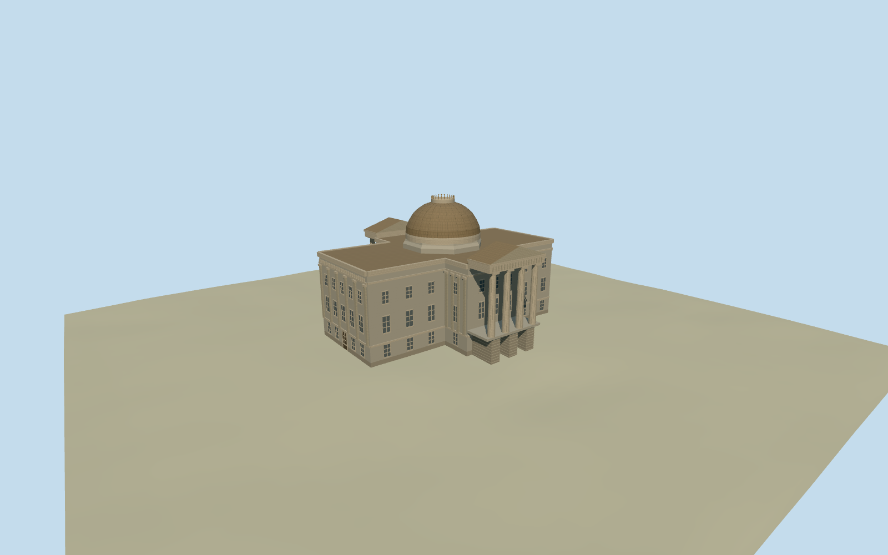

# North Carolina State Capitol

The 1840 North Carolina State Capitol in Raleigh, with gneiss wings, paired Doric porticoes and a shallow copper dome.

Authoring state: **review-in-qa.json**. Current completion evidence is in [qa.json](qa.json) and the [completion ledger](../../../../qualla-structures/batches/qualla-004.PROGRESS.md).

- [North Carolina State Capitol](https://qualla.com/north-carolina-state-capitol/)

The standing exterior of the 1840 Capitol, including paired porticoes. Park monuments and interiors are outside scope.

Vertical proportions and the latest patina of the replaced copper are estimated. The dome and crown form follow the photographs and official description.

Build: `node content/worldgen/source/places/dq/dq2/north_carolina_state_capitol/models/generate-north-carolina-state-capitol.mjs`. Add `--check` to verify exact regeneration. 14596 triangles; 7 materials; no embedded photographs.
