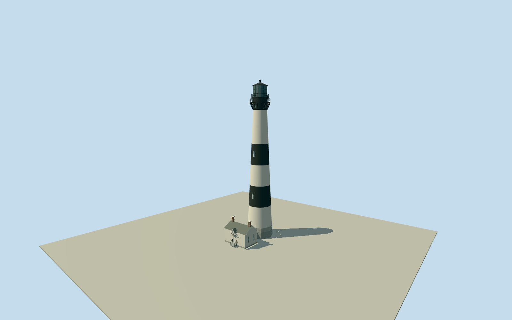

# Bodie Island Lighthouse

Surviving1872Bodie Island Lighthouse exterior with five horizontal daymark bands, octagonal granite base, recessed5shaftwindows/four servicewindows,16bracket flared black lowergallery/uppergallery/openrails,16-sidedglazedlantern/threepanerows/darkroofball, intrinsic attached white gabled oilhouse/workroom/passage, four sashwindows/twobrickchimneys and bracketed westentry/foursteps. Native center/axis plus official physical dimensions and exactNPS2021PDexteriors; no detachedquarters/sitefence/grounds/interior.

Authoring state: **review-in-qa.json**. Current completion evidence is in [qa.json](qa.json) and the [completion ledger](../../../../qualla-structures/batches/qualla-002.PROGRESS.md).

- [Bodie Island Lighthouse](https://qualla.com/bodie-island-lighthouse/)

Exact named towerway295323506/Q4286384and connected OilHouseway326756769fix identity/center and southwest entrance axis; detached DoubleKeepersQuartersway232984092and site features excluded. Tower mean circle anchor[-75.5633087368421,35.81855783157894]; preserved original mapped circleabout9.84mdiameter and oilhouseabout10x7.4m are approximate mapping envelopes, not surveys. Official registered architectural text instead documents28ftgranite base diameter and27ft5inx18ft4inoilhouse; geometry uses those physical dimensions while preserving mapped center/front reference. No terrain/image rescale to reconcile footprints. Native48mheight and15.4mseamarklandmarkheight are inconsistent with official164.4ft=50.10912mground-to-ventilator-ball;156ftis sea-to-focalplane,150ftground-to-focalplane. Use distinct official datums; exact section/window/roof details and map/hostcontact remain estimates.

Three exact primaryNPSgovernment originals dated2021-12-12were inspected after publishedQuallainventory. ExplicitsoleCapeHatterasNationalSeashorecredit/FullGrantingRightsand originalbytes are bound. Unspecified-authorQualla1871drawing/1928aerial, attributionphotos, unrelatedOuterBanks views and exteriorartwork unused as modelcontrols. No copied pixels/generatedtextures; permanent surviving exterior only, currentcosmeticconditionunverified.

Official50.10912mground-to-ventilator-ball governs totalheight;156ftis sea-to-focalplane,150ftground-to-focalplane. Granitebase8.5344mdiameter/3.3528mhigh, nominal6.7056mpaintbands, oilhouse8.3566x5.588m and2.1336mpassagewidth are physical textcontrols. Nativeenvelopes are larger/approximate, retained unchanged, not forced to model footprint or terrain. Heights of small sections, window/casing placement, roof/chimney/canopy/railing details and concealed rear joints remain bounded estimates.

Whole individual tower and intrinsic connected oilhouse/passage exterior only. Fivebodywindows+fourservicewindows, twoopen galleries/corbel brackets/closed16-sidedlantern, octagonalgranitebase and oilhouseentry/foursteps/twochimneys retained. Separate doublekeepersquarters/visitorcenter/storehouse/cisterns/sitefence/paths/boardwalk/marsh/landscape, interiors/lensreplica/signage/people/vehicles and temporaryworks excluded.

Independent160mTerrariumfield stays unchanged at fixed southwestentry. Grid samples/source pixels are not survey accuracy; sandy grass/pavement/base/threshold and host contact remain approximate. No fullsite slab or authored landscape.

Build: `node packages/worldgen/scripts/generate-authored-places.mjs --ids=bodie_island_lighthouse`. Add `--check` to verify exact regeneration. 8542 triangles; 7 materials; no embedded photographs.
