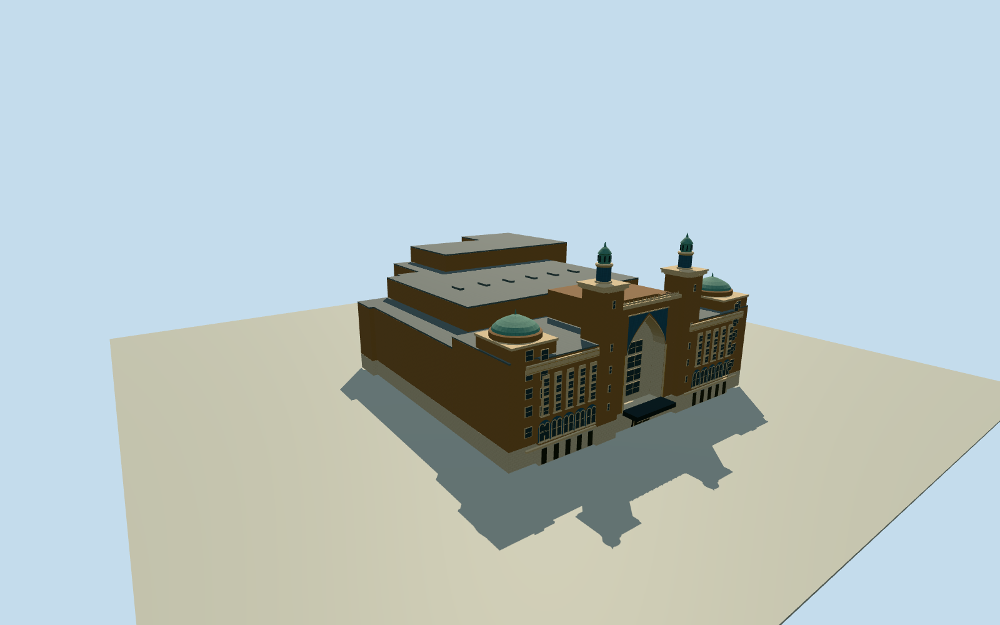

# Altria Theater, Richmond

Moorish Revival theater with twin brick towers, patinated copper lanterns, a recessed pointed arch, terracotta ornament and an extended auditorium roof behind North Laurel Street.

Authoring state: **review-in-qa.json**. Current completion evidence is in [qa.json](qa.json) and the [completion ledger](../../../../qualla-structures/batches/qualla-003.PROGRESS.md).

- [Altria Theater](https://qualla.com/altria-theater/)

Two verified Qualla CC0 street photographs establish the Laurel Street façade as documented on 2023-06-07. The tall pointed entrance recess, tower shafts and copper lanterns, window pairs and bands, limestone street base, and brick wing and corner pavilion are modeled from visible proportions.

The mapped boundary fixes the plan envelope. Rear roof, stage mass, exact building and tower elevations, and details screened from the street are medium-fi estimates. Only the June 2023 exterior is represented.

The original 128 m DEM field is unchanged. Source ground near the Laurel Street entrance supplies Y=0. Foundation, threshold and grade remain approximate.

The model contains original geometry and shared procedural materials. Foreground objects, branded signage, surrounding sites and interior features are outside its scope.

Build: `node content/worldgen/source/places/dq/dq8/altria_theater/models/generate-house.mjs`. Add `--check` to verify exact regeneration. 7930 triangles; 6 materials; no embedded photographs.
