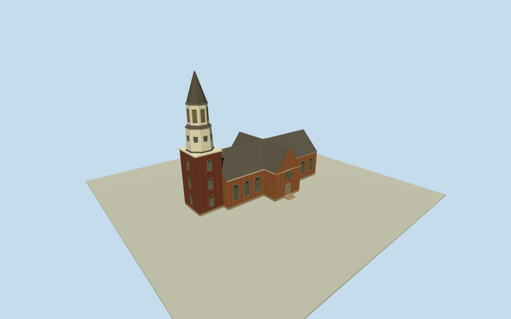

# Bruton Parish Church, Williamsburg

Colonial brick church with a cross-shaped plan, round-headed windows, steep shingle roofs and a two-stage octagonal steeple above the western tower.

Authoring state: **review-in-qa.json**. Current completion evidence is in [qa.json](qa.json) and the [completion ledger](../../../../qualla-structures/batches/qualla-003.PROGRESS.md).

- [Bruton Parish Church](https://qualla.com/bruton-parish-church/)

The April 2007 public-domain Qualla exterior establishes the south façade, rounded openings, weathered Flemish-bond brick, contrasting plum tower and two pale octagonal steeple stages.

The landmark nomination gives the documented wall and overall steeple heights. The roof pitch, intermediate tower sections, rear openings and entry steps are proportional estimates.

The original terrain field supplies the south threshold datum. The street, churchyard enclosure, memorials, trees and interior are outside the model.

The geometry and shared surface materials are original. No reference pixels are embedded.

Build: `node content/worldgen/source/places/dq/dq9/bruton_parish_church/models/generate-house.mjs`. Add `--check` to verify exact regeneration. 2363 triangles; 5 materials; no embedded photographs.
