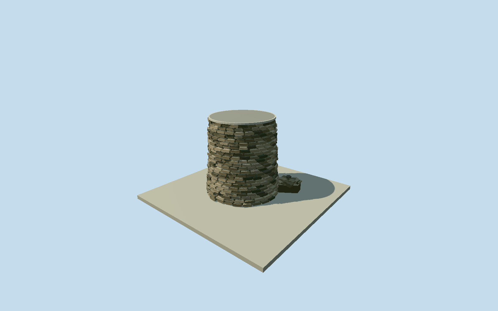

# Catharine Furnace

Whole surviving Catharine Furnace stone-stack remnant in its current capped state: tapered nearcircular body, individually shaped projecting fieldstone courses/deep irregular joints/varied original warmgrey-olive stone colors, continuous pale protective cover/rim and short attached low rubble base. Three cleared2023NPS Qualla corpus renditions only; no photographic textures. NPS20ft description informs approximate6.1m height, with original photo-estimated radius/taper/courses/cap/footing. Fixed storysite anchor is approximate and differs12.7m from the separate native identityPOI; original plan is not a surveyed/mapped footprint. Hiddenrear/tuyeres/interior-under-cap/preciseprofiles/currentfinefinish/census/footingbearing and groundcontact unverified. Vanished36ft furnace/ninefactorybuildings/industrialgrounds/earthknoll/vegetation/fences/trails/signs/arttext not reconstructed.

Authoring state: **review-in-qa.json**. Current completion evidence is in [qa.json](qa.json) and the [completion ledger](../../../../qualla-structures/batches/qualla-002.PROGRESS.md).

- [Catharine Furnace](https://qualla.com/catharine-furnace/)

NativeOSMnode3058253071 names Catharines Furnace Ruins but provides NO measured footprint or shaftcentre. Fixed Qualla storypoint[-77.64835,38.28866] is used as approximate site anchor before terrain/geometry; nativeidentityPOI is about12.7m east/north and is retained as a separate approximate point, not converted to a building polygon. NPS currentplace description identifies the surviving stack base; its20ft image description is an approximate height guide, separate from vanishedhistoric36ft stack. Visible nearcircular plan/radius/taper/protectivecap/attachedlowfooting to be originally photo-estimated after independentfieldfreeze. Exact centre/radius/backshape unknown; preview/replacementfalse.

All floor/radius/section/geometry choices follow unchanged original256m129x12916641sample/one rawtile/fixedapproximate-storysite80.9407m provider-relative datum freeze. Three cleared2023NPS Qualla photos show a tapered roughfieldstone stack remnant with a pale continuous protective cover/rim and short attached low stone base. Original photo estimates: average base radius2.75m/top2.35m, stone5.94m/protectivecap6.1m, irregular projecting courses and lowfooting. NPS20ft description is a rough height guide, not surveyed6.096m precision; vanished36ft furnace/nine buildings not reconstructed. Native node3058253071 is an identity/sitePOI12.7m from fixed storyanchor and supplies no metric perimeter, shaftcentre or bearing. Original circular plan/lowfooting actually drive the whole authored geometry and are clearly labelled photographic estimates, not mapped controls. Hiddenrear/tuyeres/coveredinterior/capconstruction/stonecensus/currentfinefinish/precisecentre/footingbearing remain uncertain. No invented openarch/uncappedchimney/industrialgrounds/earthknoll/trails/trees/fences/text/people/pixels. No terrainfit/flatten/reacquire/modelraising; preview/replacementfalse/exactgroundcontact unresolved.

Three cleared published2023MaryONeill/NPS corpus images individually inspected, unchanged publishedPD-USNPS policy passed, native government grant/source/accessions agree. Published1920px renditions are resized/recompressed and not native-byte-identical; local and native hashes recorded separately. Two other omittedlocalPDbasis photos, Wellfordportrait and intactfactoryconjecture unselected. No supplemental/questionable source/source-repair/reclassification/guard changes or copiedpixels. Original photo-based circular plan/taper/stonecourse geometry/pale protectivecover/lowfooting, no native measured polygon. Exact hiddenback/tuyeres/coveredinterior/capconstruction/stonecensus/currentfinish/absolute centre/footingbearing unknown; no inventedopenarch/uncappedchimney or historicalfactory.

Original256m129x12916641sample field/one rawtile/fixedapproximate-storysite80.9407m provider-relative datum frozen before every floor/radius/section/geometry choice. Storyanchor/nativeidentitypoint differ12.7m; approximate visualization position and facing only. No terrainfit/flatten/reacquire/modelraising. Exact base/hill contact unresolved; preview/replaceFootprint=false. Flatground and syntheticneighbors are review fixtures only.

Build: `node content/worldgen/source/places/dq/dqb/catharine_furnace/models/generate-catharine-furnace.mjs`. Add `--check` to verify exact regeneration. 30416 triangles; 2 materials; no embedded photographs.
