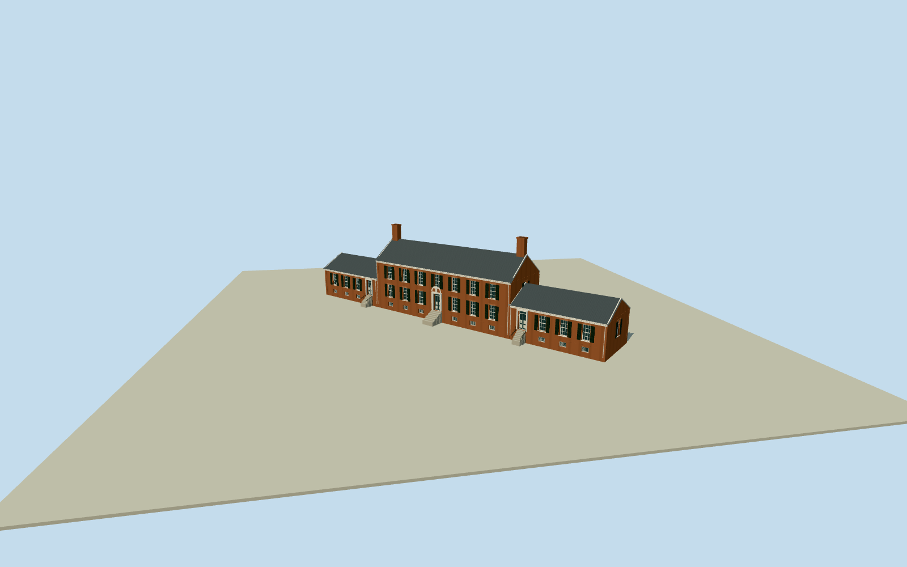

# Chatham Manor

Whole Chatham Manor: seven-bay two-storey Georgian redbrick centralhouse and both attached single-storey wings in the native four-control envelope, three slate gabledroofs/tall endchimneys/white cornice and dentils/blackshutters/recessed sash and entry doors, simplified segmental pediment doorcase/stone stairs and basementgrilles. Cleared published Qualla creator-public-domain wholehouse photograph first, distinct Highsmith garden-side publicdomain supplement. Original bounded exterior, no entireestate or separate outbuildings.

Authoring state: **review-in-qa.json**. Current completion evidence is in [qa.json](qa.json) and the [completion ledger](../../../../qualla-structures/batches/qualla-002.PROGRESS.md).

- [Chatham Manor](https://qualla.com/chatham-manor/)

Actualwhole4-control currentChathamManor/attachedwing envelope, fixednativebboxanchor/heading0 before independentfield/floor/sections/geometry. Roof/centralcoreandwing subdivisions originalphoto-bounded, not surveyednativepartoutlines.

Whole actual4-control native mainhouse/attachedwings envelope physically retained in foundation everyLOD. Long axis native0-to1. Main two-story seven-bay core and single-story flankingwings are photo-bounded original subdivisions inside that whole outline, not native surveyed partpolygons. Separate kitchen/laundry/stable/gardenpavilions/gardens excluded. Window/shutter/cornice/chimney/hiddenrear census original estimates.

Original independent256m129x12916641samples/one rawTerrariumtile/SW8.5651m providerrelative datum/native4-control bboxanchor/heading0 frozen before once-only riverterraceexterior floor20.4852m and all verticalsections/geometry. Originalphoto-bounded maincore27.2mwidth/eave8.05/ridge11.45/chimneys14.0, flankingwingeaves4.7/ridges7.15/plinth1.2/entry1.3,7bays2floors/main and4baysperwing eachlongface. Heights/currentfinish/hiddenjoins/windowcensus/corniceprofile and contact notsurveyed. No later floor/sections/field/anchor fitting/flattening/reacquire/reframe/raising.

Exact published Rutke4212008 PD-user-en wholehouse original first and distinct explicit LOC Highsmith PD garden-side original. No photo pixels embedded. No estate gardens, pavilions, statue, outbuildings, people, vehicles or furnishings.

Roof/centralcore-wing subdivisions, heights, rear openings/shutter census, fine cornice/pediment profiles and current finishes are bounded original estimates. No copied relief; opaque glazing omits interiors.

Original terrain/floor/sections frozen before geometry, contact unverified, preview only and replacement false. Flatground/context neighboring houses are review fixtures.

Build: `node content/worldgen/source/places/dq/dqb/chatham_manor/models/generate-chatham-manor.mjs`. Add `--check` to verify exact regeneration. 18650 triangles; 5 materials; no embedded photographs.
