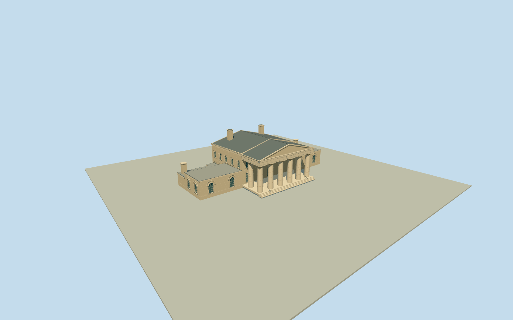

# Arlington House, The Robert E. Lee Memorial

Complete named Arlington House central two-story block/northsouthwings/nativewestoffsets plus intrinsic deep east eight-column Doric portico: six front and two return smooth massive tapered columns, open porch/recessed closed entry and upper sash, pale scored faux-sandstone stucco/entablature/pediment/ownlowsteps, tall round-headed winglights/slate central pitch/low gravel wings/lower rear service sections/pale chimneys. No detached quarters/foregroundgrave/cemeteryforecourt/site.

Authoring state: **review-in-qa.json**. Current completion evidence is in [qa.json](qa.json) and the [completion ledger](../../../../qualla-structures/batches/qualla-002.PROGRESS.md).

- [Arlington House, The Robert E. Lee Memorial](https://qualla.com/arlington-house-the-robert-e-lee-memorial/)

ExactnamedArlingtonHouseway41279883/Q675702,321ShermanDrive, retains all15bodyvertices and connected wings/westwall offsets. ActualeastDoricportico is separately mapped6vertexlayer1way1500304896 sharingbodyeastedge; included as intrinsic architecture rather than omitted or treated as neighbor. Original17vertexouterunion. Actualeastporticofrontedge1to2sets heading1.573977370295046rad, +Xnorthalongfront/+Zeastfront. Anchor originalbodybboxcenter[-77.07264029999999,38.881176499999995], distinct from approximate storyreferencepoint. Nativebody43.77mfrontlength and portico19.07mwidth/rough7mdepth approximate NPS140ftfacade/60ftportico/25ftdepth; native original not rescaled to roundedtext. Separateparkrelation13655531/Q49472875is site, not building. Detached north/southquarters/nearbygrave/forecourt excluded. Fixedcentralfront approach before terrain/geometry; exact thresholds/host slope unknown.

Complete central two-story block and connected lower north/south wings, original15vertexbody/westoffsets and6vertexintrinsic portico/17vertexunion retained. Actual native axis and full native plans are not scaled to rounded NPSdimensions. Eight smooth tapering Doric columns use primary23ftheight/5ftbasediameter and6front+2return census; frontpediment/pale fauxsandstonestucco and tall archedwinglights from exact published NPSfrontphoto. Fine profiles, window census and exact vertical roof/wall sections remain medium-fi estimates.

Main slate pitched roof/low gravel wing roofs supported by NPStext; lower rear service/conservatory partition within native wings is a bounded inference from historic NPSarchitectural text, not a current rear survey. Hidden rear sash, chimney count/positions, modern ramp hardware and finish cosmetics remain estimates. Skyline preserves whole structure/eight-column open porch/stepped roofs/pediment and chimneys with sparse detail; nearlevels add genuine sash recesses, arched winglights/fan relief, Doric capitals/entablature panels, original procedural faux-stone paint ribbons and scored stucco with aperture gaps.

Exact already-cleared published NPS2008Qualla1500x1004frontoriginal only; original SHA1/explicitPD-USGov-NPS/agency photographer-publisher/NPGalleryaccession bound with tested native-release recovery for absent local categories, without editing media metadata. Null-author front image, reportcover composites, conflictedhero/portraits/interiors/historical/unrelated imagery unused. Primary NPSarchitectural text only, its web/document images not adopted; no supplemental images/copied pixels/generatedbitmap. Shared plaster/slate/gravel/paintedmetal/paintedwood and mutedglazing.

No detached north/south quarters/bookstore/neighbor structures, LEnfantgrave/foregroundmonument/cemetery/tombs/forecourt/paths/lawn/trees/people/signage/interiors. Original160mterrain/rawtile/grid/heightPNG unchanged, fixedfrontapproach before geometry; no flattening/fitting. Exact low stairs/threshold/hostterrain contact unverified; replaceFootprint=false.

Build: `node packages/worldgen/scripts/generate-authored-places.mjs --ids=arlington_house_the_robert_e_lee_memorial`. Add `--check` to verify exact regeneration. 19549 triangles; 7 materials; no embedded photographs.
