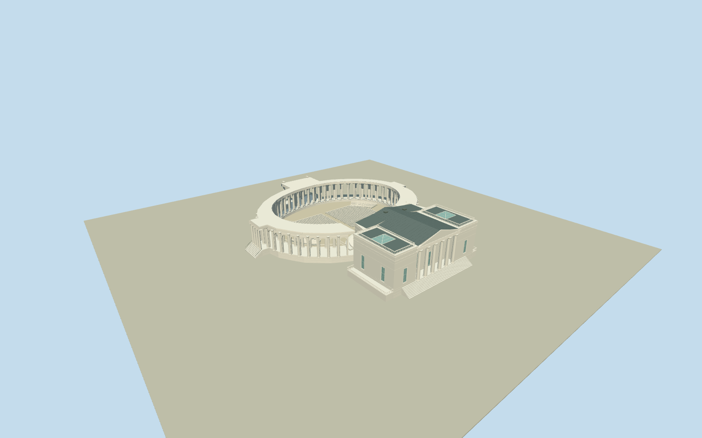

# Arlington Memorial Amphitheater

Whole Arlington Memorial Amphitheater and attached ReceptionHall: original47vertexouter/70vertexopenarena controls, elliptical covered outerround-arch/engagedDoric arcade and separateinnerDoric colonnade/openbalustrades, three axisporticos/steps, intrinsic openairbowl with straightcentralbenchblocks/curvedperimeterrows/aisles, raisedsemiovaltwolevelstage/deeprecessedprosceniumarch, T-shaped hall/eastpedimentedprostyle/sidepavilions/balustradedterraces/darkmetalroofs/twoglazedpyramids. No separateTomb/cemeteryforecourt/site mesh.

Authoring state: **review-in-qa.json**. Current completion evidence is in [qa.json](qa.json) and the [completion ledger](../../../../qualla-structures/batches/qualla-002.PROGRESS.md).

- [Arlington Memorial Amphitheater](https://qualla.com/arlington-memorial-amphitheater/)

Exact named MemorialAmphitheaterrelation15311889/Q4792362,400MemorialDrive: original47vertexouterway38457132includes elliptical coveredarcade/threeaxisporticos and attached eastReceptionHall; original70vertexinnerway1065498813is open-air seating/roofopening, not a solidroof or empty nonexistent auditorium. Anchor original inner-ring bboxcenter[-77.07300415,38.87642955]. Actualnativeeastfront straightfacevertices31to29fixes heading1.5129608715914962rad, +Xacrossfront towardnorth/+Zeast/front. Preserve full originalsignedrings without substituting genericcircle/siteboundary. Nativeplanhas no height/column/window/bench census or hallroofpartitions; those are bounded aerial/text estimates. SeparateTombnode356582211/Q3531107is approximately[-1.028,65.352]inthisframe and excluded; fixedsouthendfrontapproach[-19,61.5]avoids it. NativeoutereastfrontZ56.751m, no forecourt/promenadeextension.

Complete surviving Amphitheater/ReceptionHall exterior and intrinsic arena architecture. Original whole47/70vertexnativeperimeter/arenaopening retained in main plinth. Coveredwalkroof follows these controls with a photo-supported east interruption for the tall stage proscenium; no low roof bar crosses its opening. Individual outerarch bays/innercolumns resampled within original curves;56nominalbays with stage interruption, exactcensus/fineprofiles/fluting/benchcounts and all vertical sections are bounded interpretations of three cleared aerials and primarytext, not surveyed replicas. Skyline coarsens original rings/column cadence and seating; district simplifies roundarches to open pier bays; near levels add archvaults/engaged columns/shaft and trim detail.

Real openairarena roofopening with own floor, straightcentralbenchblocks/curvedperimeterrows/aisles; stage has two raisedsemioval levels and genuinelyrecessedprosceniumarch againstclosedhallbackwall/door. Hallincludes eastprostylepediment/sidepavilions, darkmetalhip/gableroofs and twoglazedpyramids/openbalustrades. Hidden hallroofpartitions, sash/roofgear, terrace/stair projections and modern cosmetics remain estimates. No interiorrooms/displays/sculpture/lettering.

Only three exact already-cleared QuallaDuaneLempkeCC0aerial originals2013/2022; primaryCommonsnativeSHA1/source-author/cc-zero records bound. No supplemental images, copied pixels or generatedbitmap. PrimaryHABS2020indexed architecturaltext facts only; document photographs/drawings unused. Shared proceduralmarble/concrete/paintedmetal with mutedglazing only.

SeparateTombofUnknownSoldier/Q3531107atlocal[-1.028,65.352], itsforecourt/graveplatform and all cemeteryroads/plazas/grounds/trees/graves/statues/flagpoles/flags/people excluded. Ownhallfrontsteps endaboutZ60.4, before Tomb. Original160mterrain/rawtile/grid/PNG frozenunchanged at fixedsouthendfront[-19,61.5]; exactfloor/threshold/hostcontactunverified; replaceFootprint=false.

Build: `node packages/worldgen/scripts/generate-authored-places.mjs --ids=arlington_memorial_amphitheater`. Add `--check` to verify exact regeneration. 52503 triangles; 6 materials; no embedded photographs.
