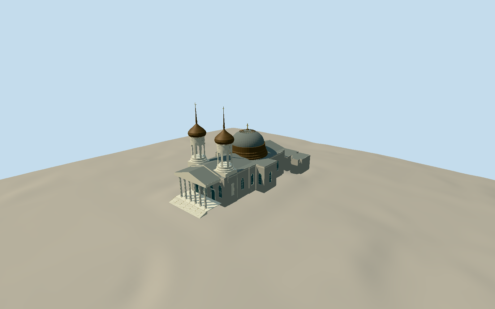

# Baltimore Basilica

Whole surviving Latrobe basilica exterior: detailed native church footprint/returns/apse and attached low rear service/chapel masses, six-column Ionic portico/open entrance/stair/pediment, paired square-based open cylindrical arched belfries/copper onion cupolas/needle spires/crosses, central stepped round dome drum/slate double-shell cupola/crown skylights/cross, tall arched multi-pane windows/ashlar walls/recess panels/roof parapets. Exclude neighboring offices/housing, grounds/independent statues/art/landscape and interiors. Main ashlar body/arched recessed glazing, low connected rear wings and semicircular apse, actual open portico and belfry arches, simple Ionic volutes/fluted shafts, copper bulb/needle profiles and real stepped roof/drum. Keep independent statue/landscape/interiors excluded. Model dimensions/ornament/rooflight and hidden annex sections approximate.

Authoring state: **review-in-qa.json**. Current completion evidence is in [qa.json](qa.json) and the [completion ledger](../../../../qualla-structures/batches/qualla-002.PROGRESS.md).

- [Baltimore Basilica](https://qualla.com/basilica-of-the-national-shrine-of-the-assumption-of-the-blessed-virgin-mary/)

Actual named churchway337697161/Q1968407 (117closednodes) and native round domepart1014414329 anchor the whole church. Dome centre fixes anchor[-76.61612375789473,39.29442909473684], weighted longwall west-facing heading-1.5243315476765846; +Z west/portico, +X south. MediaGPS39.295278 is north of actual church and unused. Native footprint includes intrinsic connected rear masses; not whole block or adjacent BasilicaPlace housing. Photo-proportional wall13.8m/parapet15.4m/portico roof17.4m, dome~30m/cross and spires~46m, window/grille/column and annex sections are architectural estimates, not surveyed heights.

Historical masonry plinth/floor1.6m above fixed external west approach, chosen before geometry; individual footprint foundation toes sample independent modern field. Exact church floor/sill/oldgrade not surveyed; no field flattening or fitting.

Whole named surviving basilica and connected native rear wings/apse are included, with actual central dome part and six-column open west portico/twin open arched cylindrical belfries/onion cupolas/needle spires/crosses. Precise wall/dome/spire heights/column orders/fine moldings/flute sections/clockfaces/rooflight hardware/hidden rear annex roofs are bounded photographic estimates; interiors and independent artworks/statues omitted.

Qualla-first15families/one unrelated hero conflict: two Smallbones2012Own/selfCC0 interiors individually inspected/native hashes bound, ancillary only. Clear supplemental Ext-Current explicit named photographerDeadwildcatOctober2006/directPD-user-en/exactnativeSHA1/revision/original upload row/dimensions/bytes bound and individually inspected; direct creator declaration parsed without editing source metadata or inventing Own. PublishedBasilicaExterior uploader-only attribution/modernCC/LOC403-timeout sources unused. No photographictextures/generatedbitmaps/downloadedmesh.

Independent256m129square2m16641-sample field/one original Terrarium tile frozen before geometry; values/heightPNG/tilebytes preserved. Provider34.5072m fixed west approach datum is not surveyed churchfloor. Floor1.6m/intrinsic stair/plinth estimate fixed before geometry; foundation toes sample original field, not wholeblock platform. Source ground never flattened/fitted/reacquired; actual host footing contact unverified, ordinary geographic preview/replacement disabled.

Four LODs retain whole church/native dome/open portico and paired belfry voids/onion/needle profiles. Native fine returns, window mullions, Ionic volutes/flutes and copper seams reduced with distance; named structure geometry never replaced with neighboring housing, office, grounds, sculpture or interior.

Build: `node packages/worldgen/scripts/generate-authored-places.mjs --ids=baltimore_basilica`. Add `--check` to verify exact regeneration. 35050 triangles; 6 materials; no embedded photographs.
