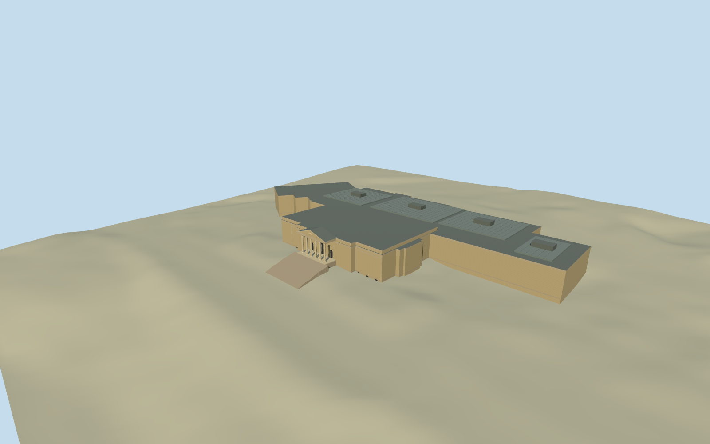

# Baltimore Museum of Art

John Russell Pope’s six-column limestone museum entrance above the terraced stairs, with the mapped galleries and later wings.

Authoring state: **review-in-qa.json**. Current completion evidence is in [qa.json](qa.json) and the [completion ledger](../../../../qualla-structures/batches/qualla-004.PROGRESS.md).

- [Baltimore Museum of Art](https://qualla.com/baltimore-museum-of-art/)

The six-column historic entrance and street-facing limestone masses are modeled from cleared exterior photographs. Later roofs and obscured service elevations are simplified to mapped masses.

Stair rise, column height, shallow relief motifs and roof-heights are proportion estimates. Exterior sculpture, gardens and gallery interiors are outside the selected scope.

Build: `node content/worldgen/source/places/dq/dqc/baltimore_museum_of_art/models/generate-baltimore-museum-of-art.mjs`. Add `--check` to verify exact regeneration. 4606 triangles; 5 materials; no embedded photographs.
