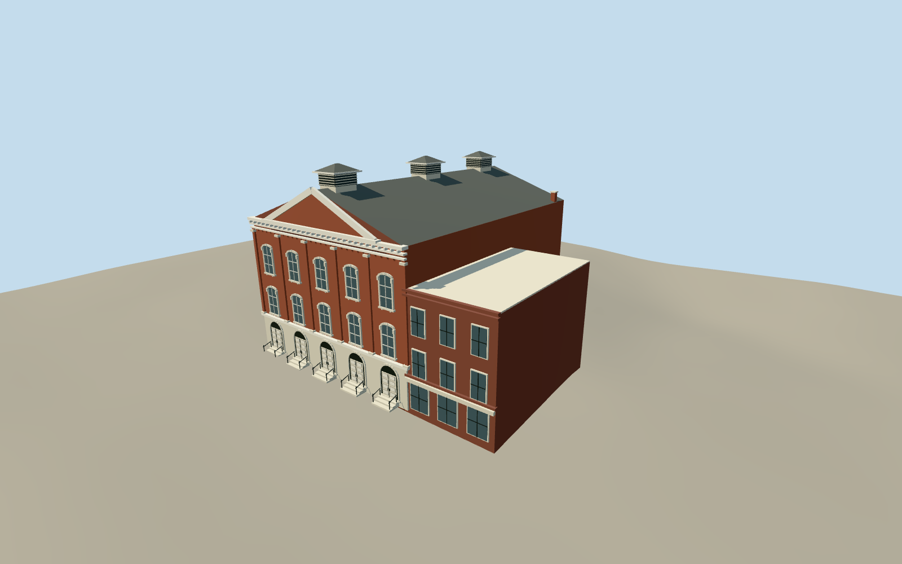

# Ford's Theatre

Red-brick theatre with five-bay white stone arcade, two tiers of tall arched windows, raised central pediment and slate gable.

Authoring state: **authored-exterior-see-current-qa**. Current completion evidence is in [qa.json](qa.json) and the [local 100 ledger](../../../../qualla-structures/batches/PROGRESS.md).

- [Ford's Theatre](https://qualla.com/ford-s-theatre/)
- [Ford's Theatre](https://qualla.com/fords-theatre/)

Current five-bay theatre and lower south Star Saloon wing, original medium-fi exterior geometry. No interiors, neighboring taller buildings or borrowed meshes.

Generalized Protomaps ensemble partition and facade proportions are estimates. Qualla 2014/2016 photographs control the visible front; historical HABS side/rear drawings guide otherwise unseen ventilation and service form.

Terrarium host samples supply ground evidence, not a survey. The foundation extends 1.25 m below the street reference; terrain-contact placement samples the declared front reference point. Dataset resolution and vertical accuracy remain host-dependent.

Fine carved window ornament and small hardware are simplified; archival rear openings/roof vents are interpreted where current photographs do not show them. Photographs and drawings are not embedded or redistributed.

Build: `node packages/worldgen/scripts/generate-authored-places.mjs --ids=fords_theatre`. Add `--check` to verify exact regeneration. 8034 triangles; 6 materials; no embedded photographs.
