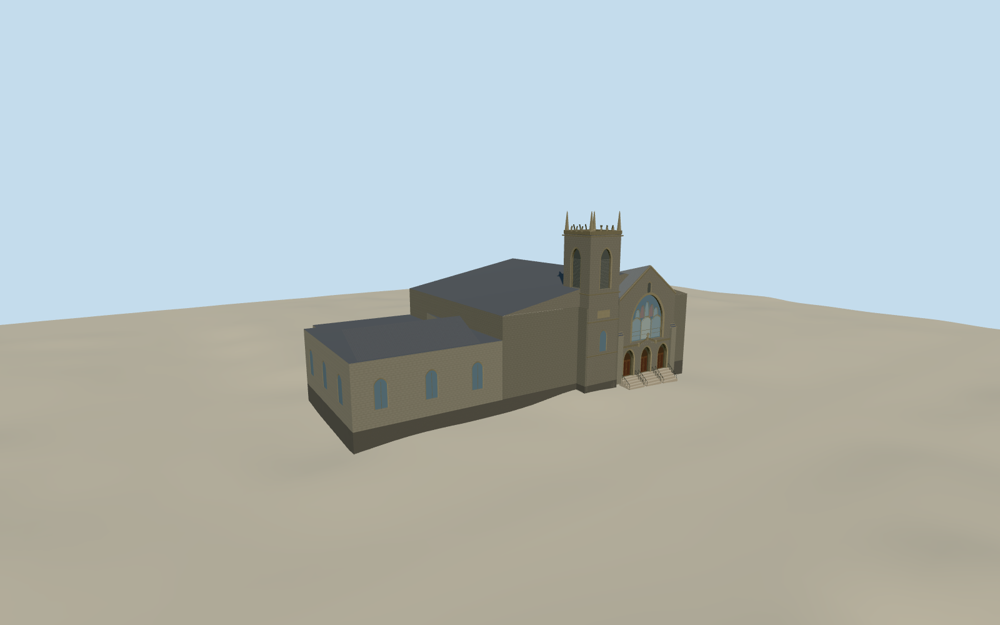

# Foundry United Methodist Church

Foundry United Methodist Church at 16th and P Streets NW, with three recessed Gothic portals, a stone tracery window, square pinnacled belfry and connected corner annex.

Authoring state: **review-in-qa.json**. Current completion evidence is in [qa.json](qa.json) and the [completion ledger](../../../../qualla-structures/batches/qualla-003.PROGRESS.md).

- [Foundry United Methodist Church](https://qualla.com/foundry-united-methodist-church/)

The March 2020 image controls the east front and bell tower. The rear roof and wall details, southern annex elevations and unsurveyed heights are approximate.

Stone tracery, stained-glass colors and porch relief are original simplified geometry. The modern front photographs cover the street-facing details.

The independent elevation field is preserved. Entrance steps and their pavement contact are approximate.

Build: `node content/worldgen/source/places/dq/dqc/foundry_united_methodist_church/models/generate-foundry-united-methodist-church.mjs`. Add `--check` to verify exact regeneration. 3754 triangles; 6 materials; no embedded photographs.
