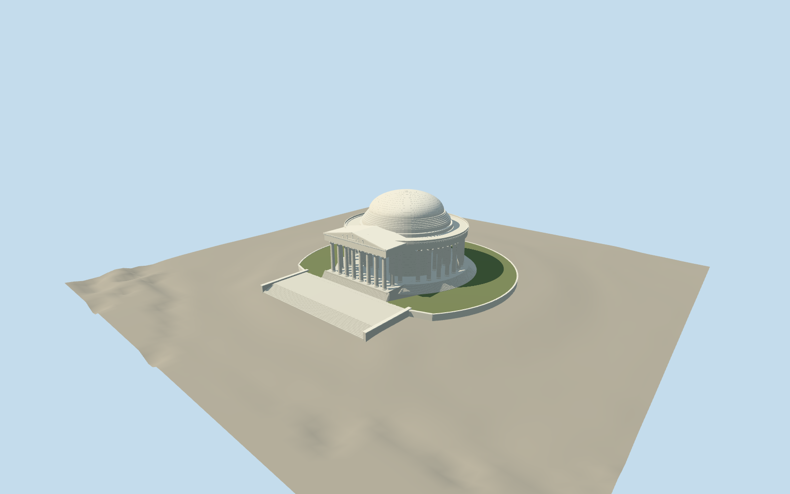

# Jefferson Memorial

Circular marble memorial with 26 outer Ionic columns, eight-column north pedimented portico and four axial inner openings, stepped dome, circular stairs and bronze standing silhouette.

Authoring state: **review-in-qa.json**. Current completion evidence is in [qa.json](qa.json) and the [local 100 ledger](../../../../qualla-structures/batches/PROGRESS.md).

- [Jefferson Memorial](https://qualla.com/jefferson-memorial/)

Original medium-fi exterior from individually inspected Qualla photographs and HABS 1994 measured north elevation and longitudinal section; not a survey or photogrammetric reconstruction.

NPS establishes 26 outer, 12 portico and 16 inner columns. Map part counts and public rounded heights conflict; measured HABS proportions control the model. Fine volutes, dome masonry and hidden pier openings are simplified.

Main circular steps, north stair flight and immediate raised supporting terrace included; wider gardens, Tidal Basin, distant approachway, undercroft and modern accessibility equipment excluded. Vertical stair levels are approximate relative to the independent terrain contact.

Standing statue and pediment relief are original simplified silhouettes, not portrait-quality sculptures. Inscriptions, exact coffer pattern and detailed interiors are excluded; no photo pixels are embedded.

Independent terrain is preserved unchanged and foundation extends beneath it. Another host DEM can change exact ground contact.

Build: `node packages/worldgen/scripts/generate-authored-places.mjs --ids=jefferson_memorial`. Add `--check` to verify exact regeneration. 63310 triangles; 4 materials; no embedded photographs.
