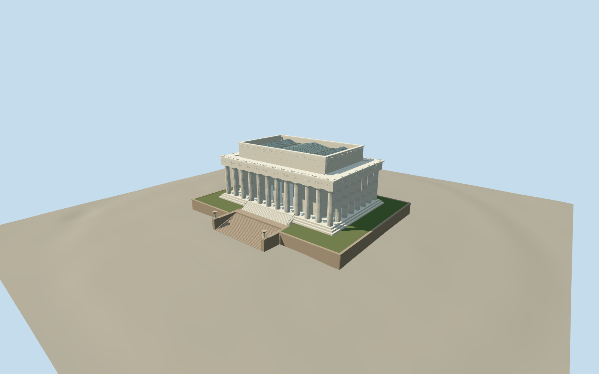

# Lincoln Memorial

Marble temple with 36 fluted outer Doric columns and two entrance columns, inset attic, open central entrance and seated Lincoln silhouette, raised terrace and separate granite/marble upper stairs.

Authoring state: **review-in-qa.json**. Current completion evidence is in [qa.json](qa.json) and the [local 100 ledger](../../../../qualla-structures/batches/PROGRESS.md).

- [Lincoln Memorial](https://qualla.com/lincoln-memorial/)

Original medium-fi temple exterior. Current controls are the exact native Sean Dudley public-domain photograph already cleared in Qualla and the original Carol M. Highsmith aerial behind its cleared edited aerial, with the photographer primary public-domain dedication. Earlier attribution images are excluded as current controls. NPS dimensions and mapped parts retained; not a measured survey.

Covered peristyle joins the original cella and entablature, replacing unintended roof gaps. Three pitched opaque rooflight volumes replace flat panels; the center field is wider. Rooflight widths10.4/18.3/10.4m and fixed27.4m eave/29.2m ridge are photographic estimates within the unchanged attic. Fine framing, concealed supports and current roof condition are approximate.

NPS dimensions control the column count, spacing, height and major massing. Fine carvings, inscription strokes, statue likeness, optical corrections and exact roof panels are simplified; inscriptions are not claimed readable.

Seated statue is an original simplified silhouette visible through the portal, not a portrait-quality replica. Side chamber murals, inscriptions, undercroft and detailed interiors are excluded.

Upper terrace and main granite/marble stair flights are included. Reflecting pool, lower pool steps, distant approachway, temporary construction and surrounding gardens are excluded.

Independent terrain is preserved unchanged; foundation extends beneath it. Another host DEM can change exact ground contact. No reference photo pixels are embedded.

Build: `node packages/worldgen/scripts/generate-authored-places.mjs --ids=lincoln_memorial`. Add `--check` to verify exact regeneration. 62834 triangles; 6 materials; no embedded photographs.
