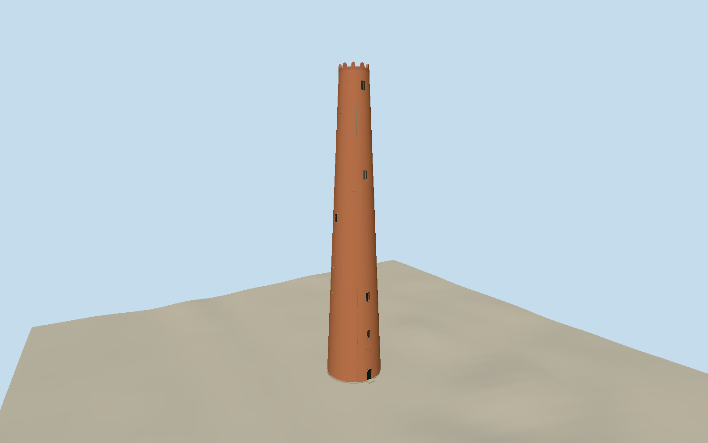

# Phoenix Shot Tower

Tall tapering red brick shot tower, four aligned west windows and sparse secondary openings, deep segmental arched iron entrance, subtle repair bands, surveyed ten-battlement concrete crown with a muted red painted appearance and flat roof deck, lightning conductors and narrow own footing/entry tread. Neighboring buildings, park monuments and flag fixtures excluded.

Authoring state: **review-in-qa.json**. Current completion evidence is in [qa.json](qa.json) and the [local 100 ledger](../../../../qualla-structures/batches/PROGRESS.md).

- [Phoenix Shot Tower](https://qualla.com/phoenix-shot-tower/)

HABS MD-21 government1936floor plans/section/west elevation now control the whole exterior:40ft1inbase,20ft4intop,215ft9inabovefirstfloor,8infirstfloor/grade difference,ten battlements and four aligned west windows. Crown peak65.9638maboveapproach; lightning conductors extend0.225mfurther. Earlier71m/16merlon interpretation and attribution/aerial imagery are excluded. Dimensions on the original sheets take precedence over coarse72m/13.4m map attributes and popular234ftfigures. Sheet measurements are a historical survey of the standing shell, not certification of every current repair.

Flat roof deck, ten elongated rounded battlements and closed bent-plate segmental iron entrance retained. Fine crown profiles, red painted finish, lightning conductors, patching, door hardware and unseen secondary openings remain original medium-fi approximations; the drawings do not establish exact present paint/repairs. The south low aperture remains a conservative closed opening, not a second certified entrance. Interiors, neighboring pavilion/buildings, park sculptures/fences/signs, tour banners and flag fixtures excluded; no photographic pixels redistributed.

Independent native terrain retained unchanged. Foundation/entrance and signed orientation reviewed as a bounded preview. Coarse urban ground and other host terrain compatibility remain limitations; footprint replacement disabled.

Build: `node packages/worldgen/scripts/generate-authored-places.mjs --ids=phoenix_shot_tower`. Add `--check` to verify exact regeneration. 4289 triangles; 6 materials; no embedded photographs.
