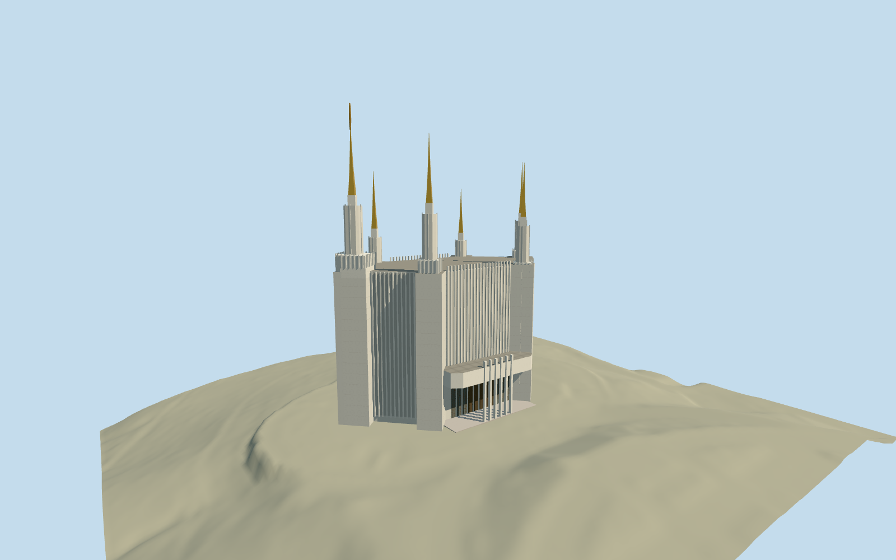

# Washington D.C. Temple

Marble hexagonal temple with six gilded spires, tall fluted façades and the north entry canopy.

Authoring state: **review-in-qa.json**. Current completion evidence is in [qa.json](qa.json) and the [completion ledger](../../../../qualla-structures/batches/qualla-004.PROGRESS.md).

- [Washington D.C. Temple](https://qualla.com/washington-d-c-temple/)

The six mapped tower bases and heights retain the standing skyline, with individual intermediate tier heights estimated from the photographs. A small abstract upper finial matches the visual scale of the highest ornament.

The exterior omits the detached annex, formal gardens, fountain and interior. Fine iconography and bronze-door graphics are simplified.

Build: `node content/worldgen/source/places/dq/dqc/washington_d_c_temple/models/generate-washington-d-c-temple.mjs`. Add `--check` to verify exact regeneration. 7920 triangles; 6 materials; no embedded photographs.
