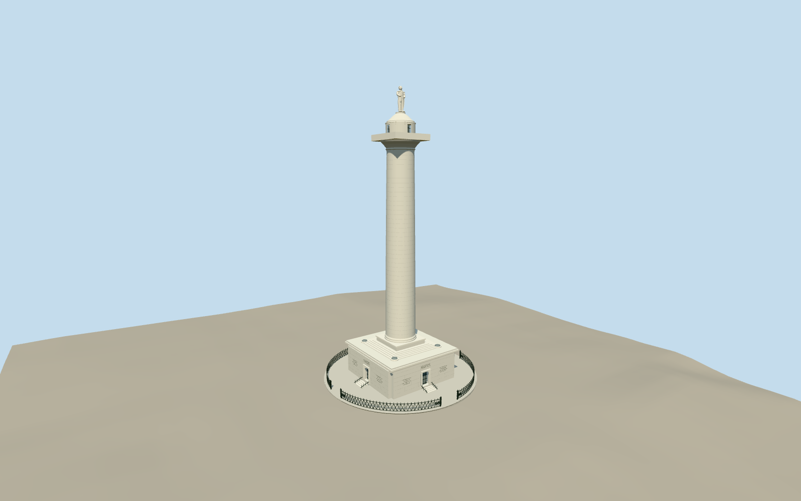

# Washington Monument (Baltimore)

Baltimore unfluted marble column on square gallery and stepped terrace, four circular skylights, Doric capital/square lookout and round bell pedestal, carved draped Washington figure with commission gesture, four door/stair approaches and own circular diamond iron enclosure. Separate park sculptures, fountains, lawns, roads and buildings excluded.

Authoring state: **review-in-qa.json**. Current completion evidence is in [qa.json](qa.json) and the [local 100 ledger](../../../../qualla-structures/batches/PROGRESS.md).

- [Washington Monument (Baltimore)](https://qualla.com/washington-monument-baltimore/)

Full fixed stone column/podium/statue silhouette/immediate railings retained. Current imagery is two exact Daderot own-photo PD-self originals after Qualla-first48paths. Actual immediate ironwork is rebuilt with diamond lattice, closed spear stocks, concentric open rosette medallions and bundled entrance piers. Earlier attribution/private/aerial controls are historical and excluded; broader whole-monument/roof/skylight/statue fidelity pending. Nominal54.46m height, roughly15m gallery and6m column diameter guide scale. Component heights, entasis, enclosure radius, carving/inscriptions and statue proportions remain estimates, not measured survey or conservation geometry.

Washington is a draped stone silhouette with uniform/gesture/folds, not a portrait scan. Hidden folds/limbs and head details are conservative authored approximations. The foreground equestrian statue in the night photograph is a separate park monument and excluded. No photographic pixels redistributed.

Only monument and immediate circular paved/iron enclosure and four approaches. Wider park monuments, fountains, landscaping, roads/buildings and temporary fixtures excluded. Current bounded independent Terrarium foundation/contact and signed placement reviewed as a preview. Coarse urban elevation and other host terrain compatibility remain limitations; footprint replacement disabled.

Build: `node packages/worldgen/scripts/generate-authored-places.mjs --ids=washington_monument_baltimore`. Add `--check` to verify exact regeneration. 62548 triangles; 4 materials; no embedded photographs.
