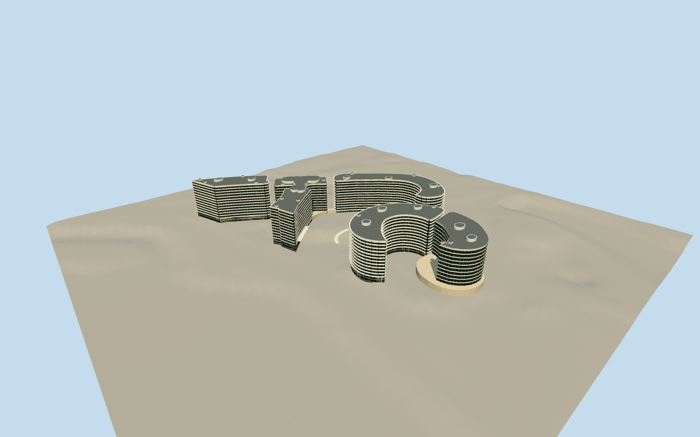

# Watergate complex

Coordinated curved residential, hotel and office blocks with recessed strip glazing, projecting residential balconies and white balustrade rhythm, flush office spandrels, low courtyard connections and rounded rooftop service forms.

Authoring state: **review-in-qa.json**. Current completion evidence is in [qa.json](qa.json) and the [local 100 ledger](../../../../qualla-structures/batches/PROGRESS.md).

- [Watergate Complex](https://qualla.com/watergate-complex/)

Original medium-fi exterior of the coordinated Watergate complex; mapped outlines and photographic proportions are generalized, not surveyed.

The three residential blocks, hotel wing, adjoining northern office and southern office are differentiated. The rounded T-shaped mapped part is a rooftop form, not another tower. Former Howard Johnson hotel is excluded.

Individual balconies, fine balustrades, service pods and roof equipment are interpretations from the selected aerial and street photographs. Not every bay, renovation or rooftop appliance is reproduced.

Low podium, entry and court structures are approximate; landscaping, pools, interiors, exact stair/ramp connections and adjacent streets are outside scope.

Coarse preserved host terrain controls ground contact; variable exposed foundation depth is not a surveyed basement elevation. References are inspected locally, not embedded or redistributed.

Build: `node packages/worldgen/scripts/generate-authored-places.mjs --ids=watergate_complex`. Add `--check` to verify exact regeneration. 49972 triangles; 3 materials; no embedded photographs.
