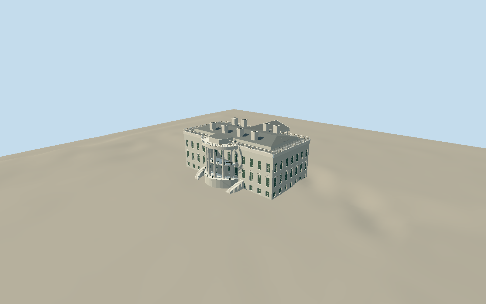

# The White House

Whole main White House Executive Residence containing the Blue Room: native main rectangle/central southern oval bay, open North and South Ionic porticos, North triangular pediment and approach stair, South terrace and curved stairs, Truman Balcony/open iron rails, alternating window pediments/multi-pane glazing, stone balustrades/cornices/dentils, hipped gray roof/central attic/8 mapped chimneys/flagstaff. Independent office wings, new ballroom, grounds/trees/fences/art and room interiors excluded.

Authoring state: **review-in-qa.json**. Current completion evidence is in [qa.json](qa.json) and the [completion ledger](../../../../qualla-structures/batches/qualla-002.PROGRESS.md).

- [Blue Room (White House)](https://qualla.com/blue-room-white-house/)
- [The White House](https://qualla.com/white-house/)

Named Executive Residence relation19761182/Q35525 checked18Sep2026, mainoutlineway238241022 and30nativeparts: mainmass/roofs/14Ioniccolumncentres/8chimneys/Southterrace/Northdeck. Mainrectanglecentre anchor[-77.03655284999999,38.89767635]; heading0, +Xeast/+Zsouth. Main52.3mx26.5m, bothporticosextendwholeenvelopeabout52.3mx47m. Native18mwall/cornice,21mroof/23mchimneys approximate mapped heights; photograph-proportional openings/capital/TrumanBalcony and fineornament estimates. Whole mainresidence only; no separate BlueRoom exterior or demolishedofficewing.

Fixed external SouthPortico approach datum16.2404m with Statefloor4m and intrinsic Southterrace4m above localzero, chosen before geometry. Northapproach grade differs naturally in independent source field. Mainfoundation and stair/terrace foundation toes sample original ground. No rescaling, flattening, reacquisition or fitting; floor/oldgrade not surveyed.

Whole main Executive Residence only; 14 native column centres and8 mapped chimney positions preserved. Photo-proportional openings/window counts, Ioniccapitals/volutes, curved balcony sections, attic wall/roof junction, curving stair treads, fine moldings and roof hardware are medium-fi approximations. No roominterior/newballroom/separateofficewings/art/grounds.

Three individually inspected exact official public-domain photographs with named staff credits/official source/federal grant and native bytes; first is cleared publishedQualla. Views are cropped component references, whole form rests on mapped components; no claim of survey or full photographic coverage. No photographictextures/generatedbitmaps/borrowedmodels.

Independent256m129square16641-sample field/two original Terrariumtiles frozen before geometry, values and hashes retained. Mainstatefloor4m over fixedSouthapproach16.2404mprovider datum is approximate. Terrain neverflattened/fitted/reacquired; hostgroundcontactunverified and replacementdisabled.

Four authored LODs preserve mainbody/bothopenporticos/TrumanBalcony/8chimneys/roof/flagstaff. Distant windows/baluster/rail/mullion/volute and dentil sections reduced.

Build: `node packages/worldgen/scripts/generate-authored-places.mjs --ids=white_house_executive_residence`. Add `--check` to verify exact regeneration. 54632 triangles; 5 materials; no embedded photographs.
