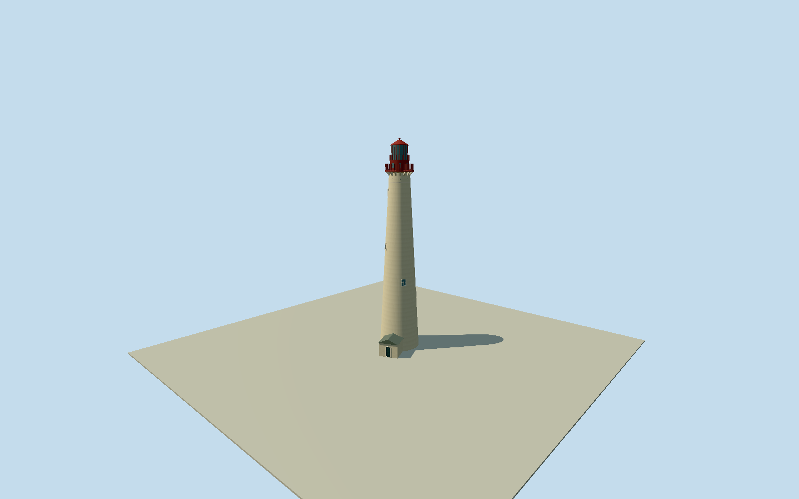

# Cape May Lighthouse

Whole Cape May Lighthouse: native twenty-control pale conical masonry shaft-and-entrance footprint, actual recessed opaque sash windows/white frames, upper collar/small vents/physical radial support brackets, red watchroom and genuinely open gallery rails/mesh, glazed lantern with mullions/open upper rail, red roof and ventilator ball. Cleared published2013SmallbonesCC0 first plus explicit Highsmith public-domain official photo; no copied pixels. Operator48.006m overallground-to-ball height; all upper sections/window facing/hidden census/entryroof estimates. Separate keeperhouses/oilhouse/grounds/beach/bunker/interiors/art/signs/trees excluded. Native plan and original field retained; exact grade contact unverified.

Authoring state: **review-in-qa.json**. Current completion evidence is in [qa.json](qa.json) and the [completion ledger](../../../../qualla-structures/batches/qualla-002.PROGRESS.md).

- [Cape May Lighthouse](https://qualla.com/cape-may-lighthouse/)

Actual named native way261320234/Q5034933 closed twenty-control tower-and-entry footprint, unchanged17 sampled tower circle controls plus original projecting entry controls. Fixed shaft-circle bbox anchor/heading0/+Xeast/+Zsouth before ground acquisition. Native plan is geographic evidence, not construction survey. Metric heights/taper/upper architecture and hidden entrance/window census are original photographic estimates after frozen field; overall48.006m height uses operator157ft6in ground-to-ventilator-ball fact.

All floors/sections/geometry authored only after immutable independent256m129x12916641sample/four rawtiles/fixedSW2.4847m provider-relative field freeze. Whole original20-control native tower-and-entry footprint drives physical shaft base and attached entrance; shaft radial interpolation passes each17 original circular controls, original entrance perimeter retains all5 native controls. Upper taper/sections/window positions/census/gallery-bracket profiles/red watchroom/openrails/lantern/roof/entryroof are original estimates from cleared2013publishedCC0 and explicitHighsmithPD photographs. Operator157ft6in ground-to-ventilator-ball supports48.006m overallheight, not focalheight. Approx shaft40.65m, watchroom43.2m, lantern46.4m, roof47.58m and ball48.006m. Hidden rear/door/roof/finefinish/windowcensus not surveyed; attached entry partly screened in acceptedphotos. Whole lighthouse retained; separate keeperhouses/oilhouse/propertygrounds excluded. No terrainfit/flatten/reacquire/modelraising, replacementfalse/exactgroundcontact unresolved.

Exact published SmallbonesCC0 original and official HighsmithPD rendition individually inspected; native original/localSHA1 matched for published photo; Highsmith uses exact catalog-listed JPEG and existing explicit primary photographer public-domain dedication, not no-known-restrictions alone. NonPD, wrong-lighthouse, unbound-author/NARA imagery excluded; no source repair or policy changes. Upper architectural sections/hidden elevations/window census/facing/watchroom panel layout/entryroof/current finish original estimates. No photographic texture/artwork/inscriptions/interiors/grounds/people.

Original independent256m129x12916641sample/four rawtiles/fixedSW2.4847m provider-relative datum frozen before all floors/sections/geometry. Native whole tower/entrance retained; no terrainfit/flatten/reacquire/modelraising. Exact construction ground/threshold contact unverified; geographic preview/replaceFootprint=false. Flat ground/synthetic neighbors are review fixtures.

Build: `node content/worldgen/source/places/dq/dqf/cape_may_lighthouse/models/generate-cape-may-lighthouse.mjs`. Add `--check` to verify exact regeneration. 14957 triangles; 3 materials; no embedded photographs.
