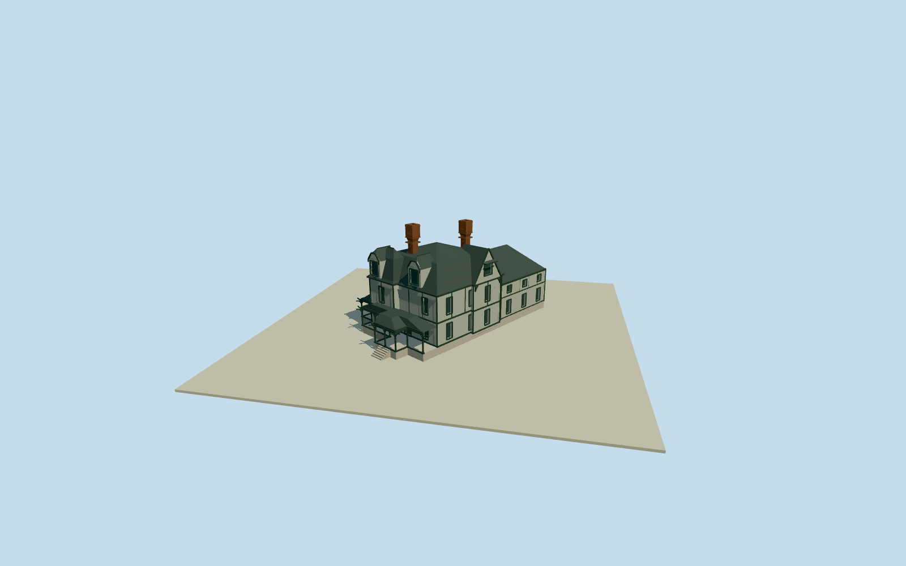

# Emlen Physick House

Whole restored1879 Emlen Physick House, the actual named/pictured house selected for CapeMay Victorian story. Native12-control whole house/attachedrearwing/porches, flared mansard/hip roofs/jerkinhead dormers/projecting southwestcrossgable, inverted stepped tall brick chimneys, exposed stickwork/woodclapboards/arcaded porch/heavycurved braces/physical sash-window and door recesses. Exact cleared published1961 JackBoucher/HABS federal photo first/only. Hidden profiles/heights/census/currentpaint-finish/contact are original bounded estimates; no copied sourcepixels/interiors/estateoutbuildings/gardens. Geographicpreview/replacementfalse.

Authoring state: **review-in-qa.json**. Current completion evidence is in [qa.json](qa.json) and the [completion ledger](../../../../qualla-structures/batches/qualla-002.PROGRESS.md).

- [Cape May: The Victorian Resort That Refused to Modernize](https://qualla.com/cape-may-victorian/)

Whole current native12-control main house/attached rearwing and porch envelope, fixed native bbox anchor/heading0 before independent field, floor/sections/geometry. Whole enduring restored1879 shell; historical photo is exterior detail evidence, not a replacement for actual current footprint.

Whole12-control nativehouse/attachedrearwing/porch envelope retained in fixed original bbox/heading0. InternalU follows actualnative0-to1 long southwestedge, internalV positive southwest; northwestfront facesnegativeU. Nativepolygon is a coarse envelope, not separate measured roof/porch/upperwall parts. Maincore/frontbay/porch/combinedroof/dormer/crossgable/chimney subdivisions are original photo-bounded estimates, all12nativeXZ controls remain in physical foundation. Rearwing is actualnative1-2-3 projection. Separatecarriagehouse/outbuildings/gardens not substituted for wholehouse.

Original independent256m129x12916641sample/two rawtiles/nativewholebboxanchor/heading0/SW2.5735m providerrelative datum frozen BEFORE all floor/sections/roof/porch/chimney/geometry. Once-only northwestporch exterior originalsample fixesfloor0.2126m. Original photo-bounded verticalsections:deck1m,porch3.75/4.65,firstfloor4.25/main7.85,mansardshoulder11.1/ridge12.3,frontbay8/12.1,SWcrossgable7.85/12.2,frontjerkinheaddormers8.3/10.6/12.1,rearwing6.3/9,twosteppedinvertedchimneys15.2/15.0. Native12XZcontrols retained. Exactheight/roofprofiles/fineornament/hiddenjoins/census/currentcolors-finish and foundationcontact originalestimates. B&W1961reference does not certify currentpaint; restrainedoriginalgray-greensiding/darkstickwork/slate/redbrownbrickpalette. No latefield/floor/anchor changes or fitting/flattening/reacquiring/reframing/raising.

Exact1961JackBoucher/HABS PD-USGov published Qualla original personally inspected/nativeSHA1matched/unchangedguardpassed; no supplemental/questionable imagery/source-rights repair/reclassification/bypass. Currentstateoperator andstatepreservation factual descriptions support enduring restored1879shell. B&W reference cannot certify currentcolors; palette/fineornament/hiddenparts/window-chimneycensus/preciseprofiles original bounded estimates. No estate/garden/furniture/sourcepixel geometry.

Originalindependent256m129x12916641sample/two rawtiles/SW2.5735m datum/fixednativebbox/heading0 beforefloor.2126m andallarchitecturalchoices. No latefit/flatten/reacquire/reframe/floorretune/modelraise. Ground/basement/thresholdcontact unverified; geographicpreview/replacementfalse. Portableflatground/contexthouses are fixtures.

Build: `node content/worldgen/source/places/dq/dqf/emlen_physick_house/models/generate-emlen-physick-house.mjs`. Add `--check` to verify exact regeneration. 12302 triangles; 6 materials; no embedded photographs.
