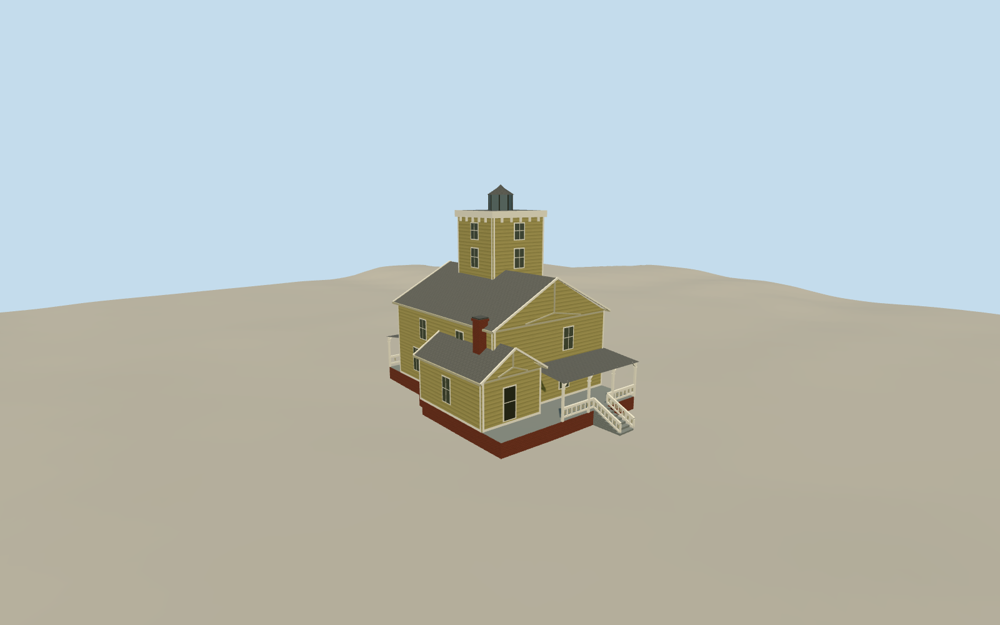

# Hereford Inlet Lighthouse, North Wildwood

The yellow Carpenter Gothic keeper house, raised porches and square lantern tower of Hereford Inlet Lighthouse.

Authoring state: **review-in-qa.json**. Current completion evidence is in [qa.json](qa.json) and the [completion ledger](../../../../qualla-structures/batches/qualla-003.PROGRESS.md).

- [Hereford Inlet Lighthouse](https://qualla.com/hereford-inlet-lighthouse/)

July 2023 keeper house and tower. The lantern is unlit and interiors, surrounding gardens and separate buildings are outside the model.

Secondary roof joins, rail and bracket carving, and exact local thresholds are approximate where the cleared photos provide incomplete coverage.

Original terrain samples are retained. The entrance and rear steps are approximate fits to that source field.

Build: `node content/worldgen/source/places/dq/dqf/hereford_inlet_lighthouse/models/generate-light.mjs`. Add `--check` to verify exact regeneration. 3220 triangles; 5 materials; no embedded photographs.
