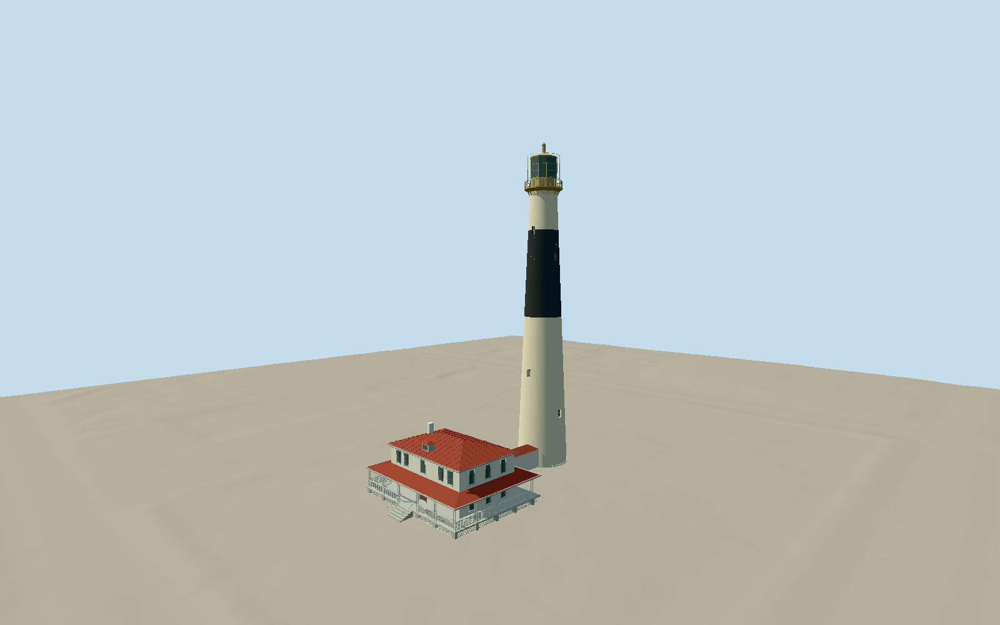

# Absecon Lighthouse

Present cream-black-cream tapering painted-brick lighthouse, sparse deeply recessed sash lights, flared pale neck and ten-sided projecting corbelled gallery, open pale/gold iron rail, tall gridded decagonal lantern with guard hoops, shallow pyramidal roof/ventilator. Native reconstructed two-storey keeper house with red standing-seam hip roof, small dormer, white chimney, bracketed cornice, five upper front sashes/two round lower lights, central entrance/stairs and open paired-column wraparound porch/balustrade, lower rear rooms and low tower link. Detached oil house/former assistant quarters, gardens and nearby buildings excluded.

Authoring state: **review-in-qa.json**. Current completion evidence is in [qa.json](qa.json) and the [local 100 ledger](../../../../qualla-structures/batches/PROGRESS.md).

- [Absecon Lighthouse](https://qualla.com/absecon-lighthouse/)

Operator171ft supplies approximate52.1208m full tower height; model baseY-.12 is relative to separate external dry-footway datum, not sea level. HABS1964 graphic-scale interpretation controls approximately8.2m base/6.3m gallery and historic lantern structure, with explicit original standards caveat. Native ring is narrower/quantized and remains geographic control, not a surveyed present brick edge.

Five full local exterior photos plus local1964 lantern drawing,30 thumbnails and three official original HABS sheets inspected. Current black-band proportions use distant photograph10 rather than historic paint depiction. Unseen rear sash positions, modern guard hoops, restored house wall/roof elevations, low link and architectural details remain photographic estimates.

Reconstructed keeper-house museum opened2001 per operator. Historic drawings do not measure this present house. Modern buildings, detached oil house, former assistant quarters, gardens/fences/lamps and navigable interiors excluded. No reference pixels used as textures.

Original USGS one-metre field remains unchanged;66049derived values and203401original pixels verified. Source classification/interpolation at hidden foundations/paving remains uncertain; default coarse Earth ground and whole neighborhood compatibility are not certified.

Build: `node packages/worldgen/scripts/generate-authored-places.mjs --ids=absecon_lighthouse`. Add `--check` to verify exact regeneration. 25318 triangles; 5 materials; no embedded photographs.
