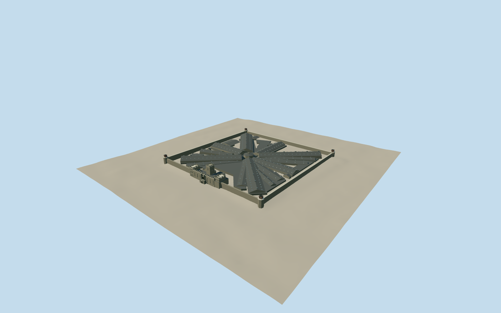

# Eastern State Penitentiary

Surviving radial prison with seven original cellblock roofs, later infill blocks, central hub, castellated Fairmount Avenue gatehouse, high stone perimeter and watch boxes.

Authoring state: **review-in-qa.json**. Current completion evidence is in [qa.json](qa.json) and the [local 100 ledger](../../../../qualla-structures/batches/PROGRESS.md).

- [Eastern State Penitentiary: The Prison That Invented Solitary](https://qualla.com/eastern-state-penitentiary/)

Original medium-fi surviving exterior from local Qualla masonry/courtyard photographs, generalized current footprints, museum map and inspected archival HABS exterior views; not a measured survey or an exact 2026 condition inventory.

Seven original radial wings, later infill and separate gatehouse are differentiated. Detailed decay, exact skylight counts, hidden roof joins, smaller yard partitions and service fixtures are generalized.

The 1855 hero lithograph is rejected as current form evidence; its historic central turret and rows of separate exercise yards are not restored.

Three mapped corner controls establish the perimeter; northeast corner closure, roof heights and unseen rear details remain photographic interpretations. Ground contact uses coarse host terrain, not surveyed pavement levels.

No interiors, surrounding streets, temporary visitor attractions or reference-photo textures are included. Research images remain local and are not embedded in runtime packs.

Build: `node packages/worldgen/scripts/generate-authored-places.mjs --ids=eastern_state_penitentiary`. Add `--check` to verify exact regeneration. 24901 triangles; 6 materials; no embedded photographs.
