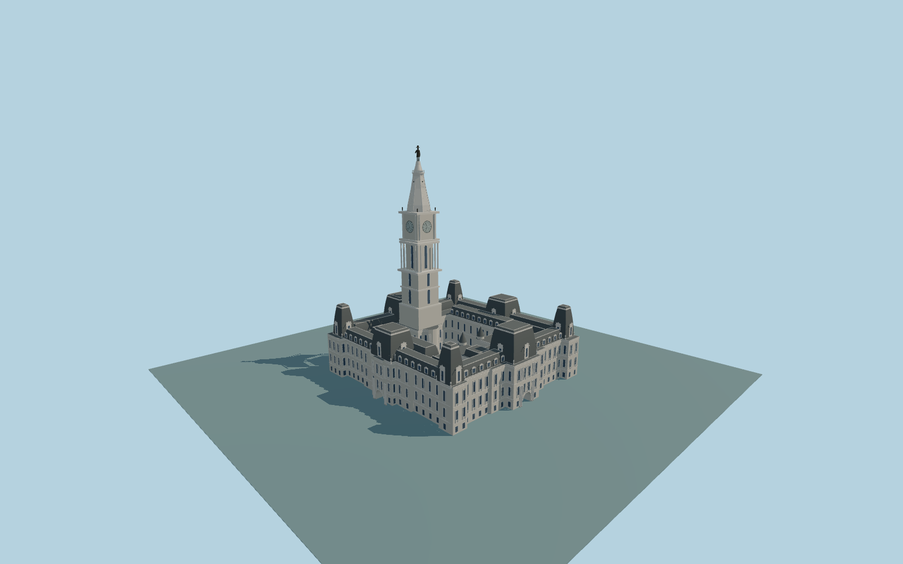

# Philadelphia City Hall

Complete pale-stone Second Empire City Hall: entire square low ensemble with three retained courtyard openings, dark slate mansards/dormers and eight raised portal/corner pavilions, four open arched passages, paired south-court round turrets, separately located north shaft/colonnade/four clock dials, pale ribbed tapered crown/open deck and original dark167m Penn likeness.

Rebuild the original checked-in source with `node packages/worldgen/scripts/generate-philadelphia-city-hall.mjs`; append `--check` for exact bytes. Import/LOD commands select `--ids=philadelphia_city_hall`. GLBs are ignored outputs; detailed source and four budgeted browser tiers remain separate.

The retained Q1138183 outline and three courtyards fix the full ensemble. All four portals stay open and the clock tower is located on the north wing.167m total must not become a whole-parent extrusion. Intermediate roof/shaft/floor levels, facade/sculpture/door inventories, the original Penn likeness and street/accessibility grades are approximate, not as-built certification. Six shared256px material graphs are reused without private or embedded images. Scope and current review: model-brief.json and qa.json.

Original geometry uses the repository license. Maps: © OpenStreetMap contributors, ODbL-1.0; Protomaps. Standard terrain and attribution: terrain-grid.json. Ordinary reference photographs remain local and are not redistributed or used as textures.
