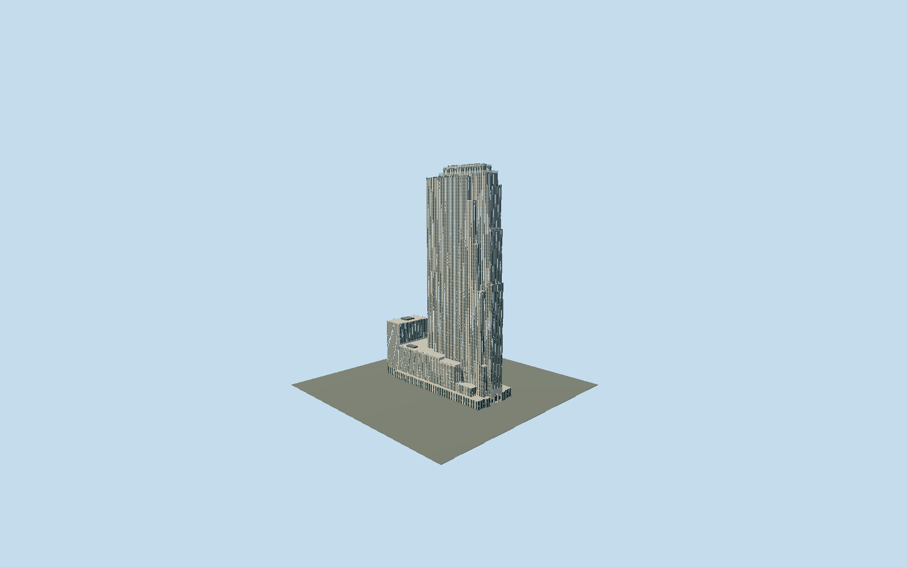

# 30 Rockefeller Plaza

Complete medium-fi Rockefeller slab, NBC studios and western wing, with six east revolving doors, western triple portal, limestone piers and three observation tiers.

## Evidence and reconstruction

Published dimensions and reconstructed details are separated in spec.json. Primary references:

- [Reference](https://s-media.nyc.gov/agencies/lpc/lp/1446.pdf)
- [Reference](https://www.rockefellercenter.com/leasing/30-rockefeller-plaza)
- [Reference](https://www.rockefellercenter.com/documents/TopoftheRockTeachersGuide.pdf)
- [Reference](https://siny.org/wp-content/uploads/2008/11/ttr.pdf)
- [Reference](https://www.rockefellercenter.com/tickets/top-of-the-rock-observation-deck/skylift)
- [Reference](https://www.rockefellercenter.com/the-beam/)
- [Reference](https://thgcreative.com/thg-gallery/top-of-the-rock/)
- [Reference](https://www.openstreetmap.org/way/487519790)

No third-party geometry, photograph or bitmap texture is embedded. Shared surface graphs come from the central library; vertex tints carry model colors. Glazing uses PBR materials; transparent surfaces are declared per model.

## Model and axes

202,765 triangles; 574,351 vertices; 10 material groups; 23,115,276 bytes. Native bounds: -82.600, 0.000, -28.799 to 82.042, 259.074, 28.799. Source hash: `sha256:ee752f03a4c05e5e722b89d09f33a429c39eca38f4db9ea2dbfa4c673a53c7c3`.

{"up":"+Y","longitudinal":"+X along the mapped building long axis","front":"+Z","origin":"Ground-level center of exact-QID mapped footprint frame"}

The geographic proposal uses exact-QID OpenStreetMap evidence. Map-derived orientation and estimated architectural details require real-site visual review; preview eligibility is distinct from geographic/fidelity approval. Map attribution: © OpenStreetMap contributors, ODbL-1.0.

## Reproduce

Run `node packages/worldgen/scripts/generate-signature-towers.mjs --ids=30_rockefeller_plaza` (or add `--check`). The generator preserves manually edited masters by checking their baseline hashes. Import through the standard authored-model workflow with optimization disabled; then capture all QA cameras, including shared-surface views.

## Pending work

- Complete medium-fi exterior includes all fourteen mapped parts, slender eastern slab, elevator setbacks, low NBC studios, western wing, three observation levels, lowered Skylift and Beam. Original201315-triangle source recipe remains in Git; reviewed source corrects the main six revolving-door casings and western triple-portal treatment. Door locations and western facade relief are reconstructed, not current surveyed hardware. LPC1985 photos/descriptions inform historic architecture; present owner pages corroborate buff limestone, aluminum spandrels and current rooftop attractions. Individual equipment offsets, intermediate heights, facade bay pitch and tier extents remain reconstructed. District uses canonical window_punched as a generic bay graphic; exact pane ratios/colors differ from street geometry. Small facade ribbing, eyelet perforations and inscriptions are below selected browser error bounds; pointed leaf silhouettes remain. Original master similarly omits tiny eyelets despite legacy camera names. Separate rink/Prometheus, Channel Gardens, neighboring Center buildings, tenant lettering and interiors excluded. Absolute grade and physical-device timings unmeasured.

This bundle follows the medium-fi standard. Medium-fi appearance and geographic fit are reviewed separately. Hash-bound visual acceptance is recorded separately after capture inspection.
