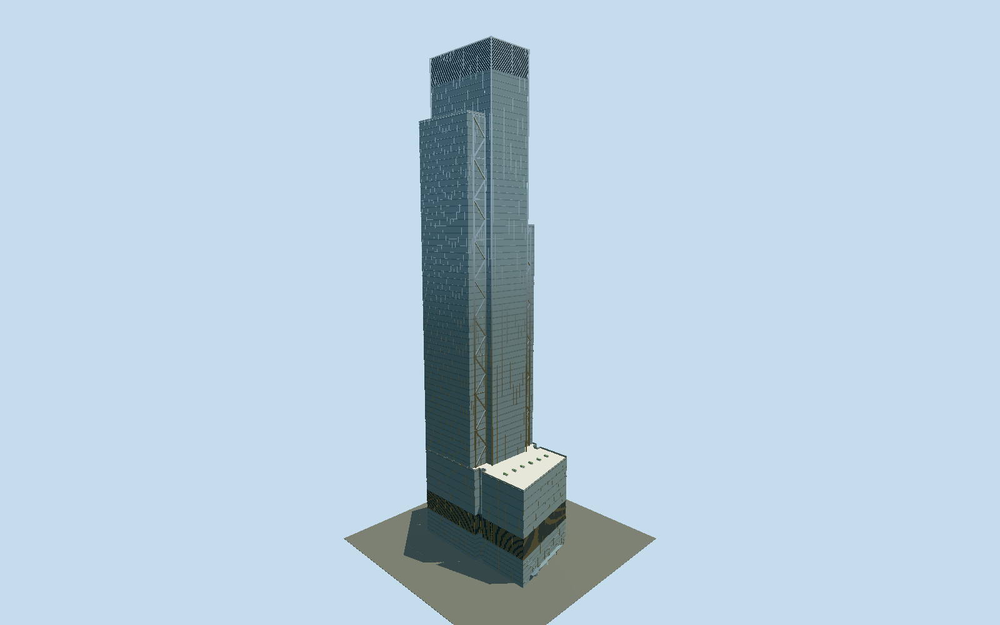

# 3 World Trade Center

Completed RSHP tower with three unequal glazed planes, external stainless-steel K braces, eight corner offices, three landscaped terraces and the skew Greenwich Street cable-net lobby.

## Evidence and reconstruction

Published dimensions and reconstructed details are separated in spec.json. Primary references:

- [Reference](https://rshp.com/projects/office/3-world-trade-center/)
- [Reference](https://rshp.com/assets/uploads/5270_3WorldTradeCenter_JS_en.pdf)
- [Reference](https://rshp.com/news/archive/rshp-celebrates-the-completion-of-3-world-trade-center-in-new-york/)
- [Reference](https://wtc.com/work-place/3wtc/)
- [Reference](https://www.openstreetmap.org/way/166839381)

No third-party geometry, photograph or bitmap texture is embedded. Shared surface graphs come from the central library; vertex tints carry model colors. Glazing uses PBR materials; transparent surfaces are declared per model.

## Model and axes

32,886 triangles; 74,290 vertices; 4 material groups; 3,071,792 bytes. Native bounds: -48.775, 0.000, -30.632 to 49.200, 328.879, 30.632. Source hash: `sha256:5bb257e7c9cf57a1187216ac946522b62c0c7e817a14a6177720d0550ccc3ffa`.

{"up":"+Y","front":"-X toward Greenwich Street and the memorial","north":"-Z toward Dey Street"}

Fresh2026-10-10 exact-Q941908 ground way166839381 and four independently mapped podium/south/north/central parts960146508–511 match all original raw source-local geometries exactly. The preserved original global map frame has anchor[-74.011692524,40.710984661] and heading-0.472632939657. Projection residual is under1mm against its rounded native outline. Architect street boundaries and completed north/south setback description sign the frame: native-X toward GreenwichStreet/memorial west-southwest, +X toward ChurchStreet east-northeast, -Z DeyStreet north-northwest, +Z CortlandtStreet south-southeast. The skew western podium edge retains its mapped shape. Primary typical-floor diagram governs the regularized three-plane upper cruciform over incomplete/overlapping mapped shoulder traces; those raw traces remain in the source and are not asserted to match every upper corner. Owner completed1079ft/328.8792m height and architect205/718/935ft terrace datums supersede obsolete320/352m raw tags. GroundY0 is an unsurveyed entry datum, and the three doorway casings/canopy are photographic reconstructions. Accept1m principal ground envelope/1degree orientation allowance, not a surveyed entrance claim. Oculus, memorial, adjacent towers, public streets and subterranean/interior fit-out are excluded. No footprint replacement.

## Reproduce

Run `node packages/worldgen/scripts/generate-signature-towers.mjs --ids=3_world_trade_center` (or add `--check`). The generator preserves manually edited masters by checking their baseline hashes. Import through the standard authored-model workflow with optimization disabled; then capture all QA cameras, including shared-surface views.

## Pending work

- The unchanged original build3Wtc recipe reproduces295672triangles/29241552bytes exactly. Reviewed source preserves the independent skew podium, three connected cruciform planes with unequal northern/southern terraces, four projecting stainless K-frame zones at original cadence, full-height central corner columns, tower/podium facade datums, closed mechanical crown, all three terrace decks with glass guards, planted gardens, reconstructed benches, GreenwichStreet cable-net lobby and three revolving door enclosures. Continuous glass walls, flat mullion/transom/spandrel strips and flat crown-louver strips replace repeated pane cells and section shells. Tiny cover-joint seams are omitted. Shared stainless and granite graphs serve two reusable textures; vegetation shares granite with green vertex tint as a deliberate coarse surface approximation, and tinted stainless approximates painted roof/bench finishes. Glass/recess use one opaque vision-glass palette; door glass retains a separate translucent palette, four near draw groups total. Skyline retains stepped envelope, flattened two-sided K-brace ribbons at original cadence, roof decks and guards, sparse40-floor facade bands and unframed mechanical recesses; it omits facade mullions, entrance hardware, planters/benches and roof equipment. District restores four-floor bands, coarse vertical mullions, two-sided flattened braces and three low-sided door casings, omitting K connection nodes, cable-net tubes, garden furniture and rooftop equipment. Street restores all facade floor datums, sparse glass guard posts, brace plates, coarse vegetation and rooftop boxes with20-sided door glass; near adds published5ft/10ft module framing, dense louvers/guards/plants, cable-net nodes,36-sided doors and rooftop grilles. Upper part regularization, exact facade phase, intermediate mechanical/lobby panel datums, K-brace spacing/section, roof service equipment, terrace furnishings and entry hardware remain photo reconstructions. Architect rounded330m height differs from selected owner1079ft/328.8792m. Physical-device/dense-city timings and surveyed curb/entry fit remain unmeasured.

This bundle follows the medium-fi standard. Medium-fi appearance and geographic fit are reviewed separately. Hash-bound visual acceptance is recorded separately after capture inspection.
