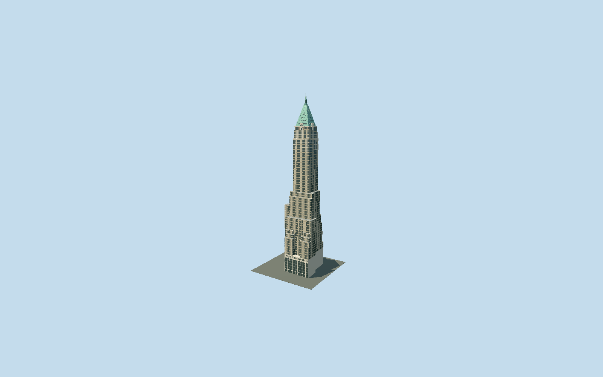

# 40 Wall Street

The Manhattan Company tower with its mapped L-shaped base and asymmetric setbacks, great limestone street colonnades, buff-brick window piers, ornamental upper stories, four Gothic wall dormers, standing-seam green copper pyramid and octagonal spire.

## Evidence and reconstruction

Published dimensions and reconstructed details are separated in spec.json. Primary references:

- [Reference](https://s-media.nyc.gov/agencies/lpc/lp/1936.pdf)
- [Reference](https://40wallstreet.com/)
- [Reference](https://www.openstreetmap.org/way/278042253)

No third-party geometry, photograph or bitmap texture is embedded. Shared surface graphs come from the central library; vertex tints carry model colors. Glazing uses PBR materials; transparent surfaces are declared per model.

## Model and axes

15,780 triangles; 39,788 vertices; 4 material groups; 1,624,528 bytes. Native bounds: -35.914, 0.000, -30.328 to 35.914, 282.550, 30.328. Source hash: `sha256:b0a2d2adfd5c440ce75290b51fa5a08aabd26b4b888da2d53f39f653c76f79ec`.

{"up":"+Y","longitudinal":"+X southeast","front":"+Z southwest Wall Street","origin":"Ground-level mapped plot center at bank street datum"}

Fresh OSM API on 2026-10-10 confirms unchanged exact Q218305 whole outline 278042253 and twenty-nine separately retained mapped parts, including roof 286057109. Signed heading -0.668872591958 retained: native +X southeast, +Z southwest. Wall Street facade is +Z south/southwest; the longer Pine Street pavilion is -Z north/northeast. Shaft remains east of plot center. Roof rectangle supplies its signed copper-pyramid frame. Ground Y=0 is bank street datum. LPC Pine/Wall elevations and cadastral plan support these asymmetric sides. Mapped part heights are estimates rather than surveyed storey sections. Accept 2 m footprint / 1 degree reconstruction allowance; automatic footprint replacement disabled. Local slope and door thresholds are unmeasured.

## Reproduce

Run `node packages/worldgen/scripts/generate-signature-towers.mjs --ids=40_wall_street` (or add `--check`). The generator preserves manually edited masters by checking their baseline hashes. Import through the standard authored-model workflow with optimization disabled; then capture all QA cameras, including shared-surface views.

## Pending work

- Original 431590-triangle, 39306480-byte detailed master remains exactly reproducible from the unchanged world-tower recipe. Reviewed source/four browser levels preserve L-shaped base, unequal Wall/Pine pavilions, mapped asymmetric setbacks and courts, limestone street colonnades, buff brick piers, darker spandrels, contrasting upper ornament, four Gothic wall dormers, turquoise copper pyramid and two-stage octagonal lantern/pole. Continuous facade backing and long piers replace independent window frames; district/street aggregate floors and skyline averages materials. Four dormers gain closed returns and the pyramid gains a top cap. Fine relief, replacement-window variations, copper seam pitch, and lantern section sizes are reconstructed. Original granite ground veneer uses a gray tint on the shared limestone graph in this medium-fi exterior. Published 927 ft sets the 282.5496 m envelope; LPC 71 floors and current owner 72 remain distinct. Three shared 256 px graphs, opaque glazing and zero images. Tenant lettering, moving flags, detailed doorway mechanisms, interiors/basement vaults, equipment and neighbouring buildings are excluded. 1.5 / 0.75 / 0.3 / 0.1 m shaft probe allowances exclude omitted fine relief/frames and distant facade subdivisions. No physical-device performance or surveyed grade claim.

This bundle follows the medium-fi standard. Medium-fi appearance and geographic fit are reviewed separately. Hash-bound visual acceptance is recorded separately after capture inspection.
