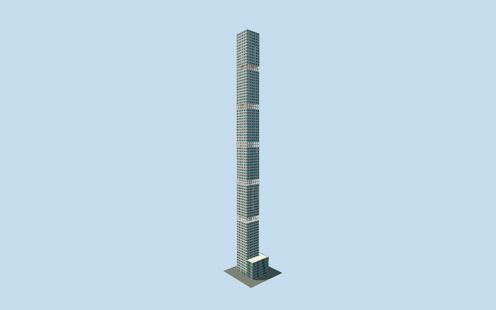

# 432 Park Avenue

Detailed exposed-concrete Manhattan tower with physically punched10ft windows, recessed aluminum hopper units, five genuine open double-storey drum levels and the separately mapped lower L-shaped podium.

## Evidence and reconstruction

Published dimensions and reconstructed details are separated in spec.json. Primary references:

- [Reference](https://www.rvapc.com/works/432-park-avenue/)
- [Reference](https://www.rvapc.com/wp-content/uploads/2016/04/2016_0601_RVA_432_FINAL_UPDATED.pdf)
- [Reference](https://enclos.com/project/432-park-avenue/)
- [Reference](https://www.sbp.de/en/project/432-park-avenue/)
- [Reference](https://mackloweproperties.com/news/pdfs/432-PA-Abitare-June-2013.pdf)
- [Reference](https://www.432parkavenue.com/assets/data/brochures/432Park_DigitalBrochure.pdf)
- [Reference](https://www.openstreetmap.org/way/261499924)

No third-party geometry, photograph or bitmap texture is embedded. Shared surface graphs come from the central library; vertex tints carry model colors. Glazing uses PBR materials; transparent surfaces are declared per model.

## Model and axes

292,272 triangles; 620,812 vertices; 6 material groups; 25,860,028 bytes. Native bounds: -25.445, 0.000, -19.185 to 21.877, 425.500, 19.283. Source hash: `sha256:848165649622904dd74f42c4d0dae6f931a8e81f0d7c73dd4515ce146aabc501`.

{"up":"+Y","longAxis":"+X toward57th Street/northeast","shortAxis":"+Z towardPark Avenue/southeast"}

The geographic proposal uses exact-QID OpenStreetMap evidence. Map-derived orientation and estimated architectural details require real-site visual review; preview eligibility is distinct from geographic/fidelity approval. Map attribution: © OpenStreetMap contributors, ODbL-1.0.

## Reproduce

Run `node packages/worldgen/scripts/generate-signature-towers.mjs --ids=432_park_avenue` (or add `--check`). The generator preserves manually edited masters by checking their baseline hashes. Import through the standard authored-model workflow with optimization disabled; then capture all QA cameras, including shared-surface views.

## Pending work

- Complete static medium-fi exterior of the 425.5m square concrete tower and its mapped adjacent L-shaped lower podium, including all five authored double-row open mechanical bands and cylindrical cores, 56th Street arrival and roof. The unchanged 292,272-triangle detailed source master is reproducible. Four separate browser recipes preserve all principal masses and open levels. District uses the reusable 256px window_punched graph at an explicit six-column, 90-geometrical-row motif phase; its generic opening ratio and pane color approximate the building, and graph tiling is not a metric window survey. Street restores every authored square pane and closeup restores intrados, simplified perimeter/hopper frames and core ribs. Centimeter joints, handles, hardware, measured core drums, terrace furnishing, interior fit-out and live tenant signage are outside browser detail. Ninety geometric rows and marketing floor numbers are distinct. Standalone Park Avenue retail cube and neighboring older buildings are independent site structures outside this tower/podium asset and remain eligible for ordinary map rendering; replacement is disabled. No downloaded mesh or copied facade photo is redistributed. Three mapped arrays were freshly confirmed unchanged, and the southwest entry fixes signed orientation. Absolute site elevation, street grade and physical phone/laptop timings remain unmeasured.

This bundle follows the medium-fi standard. Medium-fi appearance and geographic fit are reviewed separately. Hash-bound visual acceptance is recorded separately after capture inspection.
