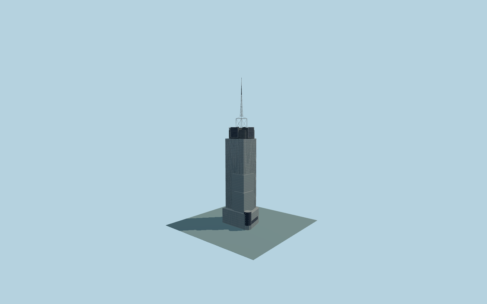

# 4 Times Square / One Five One

Complete individual4 Times Square glass-and-masonry stepped tower with80/120/160m trim wings,200m main body,rounded220m neck,four225m sign arms,225m central mechanical roof,open246.5m mast cage andseparate341m segmented broadcast antenna. Whole35m low parent,Nasdaq northwest display cylinder withactual window apertures andsouth42nd Street recessed three-drum entry complete the exterior.

Rebuild original checked-in source with `node packages/worldgen/scripts/generate-four-times-square.mjs`;append `--check` for exact bytes. Import/LOD select `--ids=4_times_square`. GLBs are ignored outputs. Native Q687413 whole parent andindividual tower/corner/roof/mast parts fix orientation andscale. Independent One Bryant Park andcity context are excluded.

Four existing shared256px graphs;no private/embedded textures. Detailed master andfour browser tiers remain separate. Native17m datum andall curb/entry/accessibility levels are approximate. Facade,door,sign,roof,mast/communications inventories are original photo-proportional reconstructions,not as-built verification;ads/branding/night lighting are not copied. Full scope/limits inmodel-brief.json andqa.json.

Original geometry uses repository license. Maps:© OpenStreetMap contributors,ODbL-1.0;Protomaps. Terrain attribution/hashes:terrain-grid.json. Linked photographs are references only,not redistributed orused as textures.
