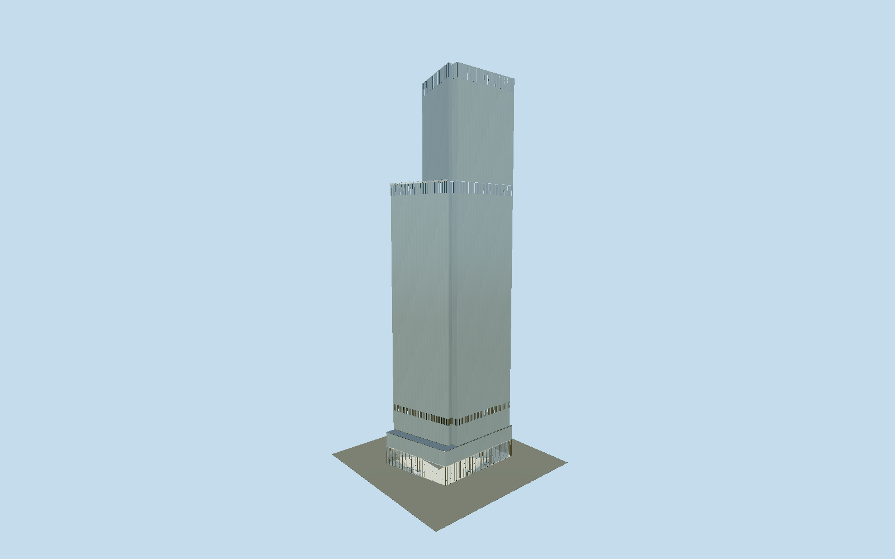

# 4 World Trade Center

4 World Trade Center: separate notched parallelogram and upper trapezoid, northwest triangular terrace, finely jointed silver glass, vertical mechanical louvres, clear tall lobby, revolving entrances and independent mapped retail envelope.

## Evidence and reconstruction

Published dimensions and reconstructed details are separated in spec.json. Primary references:

- [Reference](https://www.maki-and-associates.co.jp/projects/WTC?lang=en)
- [Reference](https://www.tozai-as.or.jp/mytech/19/19-maki15.html)
- [Reference](https://www.silversteinproperties.com/portfolio-properties/4-world-trade-center)
- [Reference](https://d2y2r48zu7mp3w.cloudfront.net/properties/828ee848-28fb-433a-a8bc-784260f45c15/2232a3a2-f658-437e-8f4c-aa66accd4649.pdf)
- [Reference](https://www.lera.com/world-trade-center-tower-4-more-descrip)
- [Reference](https://www.permasteelisagroup.com/historic-project/four-world-trade-center/)
- [Reference](https://www.skyscrapercenter.com/building/4-world-trade-center/545)
- [Reference](https://www.openstreetmap.org/way/278033587)

No third-party geometry, photograph or bitmap texture is embedded. Shared surface graphs come from the central library; vertex tints carry model colors. Glazing uses PBR materials; transparent surfaces are declared per model.

## Model and axes

60,464 triangles; 119,810 vertices; 4 material groups; 5,041,440 bytes. Native bounds: -42.410, 0.000, -32.188 to 42.411, 297.700, 32.204. Source hash: `sha256:1126e873ebf1d308696367b4a875cbc4f737d9565de7d95ba82d7748a921a671`.

{"up":"+Y","longitudinal":"+X east-southeast along local map frame","front":"+Z south-southwest","origin":"Mapped ground-envelope center at terrain contact. Independent office plan has an explicit inferred offset."}

Fresh2026-10-10 exactQ1351208 OSMway278033587/rawring and independent NYC BIN1088795 photogrammetric outline confirm the separate ground envelope. Preserved anchor[-74.012017084,40.710325481]/heading-.513459789133: native+X ESE bearing119.419degrees towardChurchStreet and native+Z SSW bearing209.419degrees towardLibertyStreet. Owner level28plan actually inspected with north annotation: Greenwichwest,Churcheast,Libertysouth; opposed northeast/southwest corner notches and architect upperplan northwest triangular cut independently sign direction, not a180degree arbitrary rectangle. Architect siteplan independently labels memorialwest/3WTCnorth/Libertysouth. Office floorplate remains separate from base envelope; reconstructed57.912m edge and[2.6,2.7]translation retained with undimensioned proportions, not independently surveyed. Raw OSMring agrees within.002m rounding. Municipal ground/roof attributes not used as meter datums. Y0 is approximate localpavement, no measured curbgrade or footprintreplacement. Lobbydoor allocation and plant pitch are visual reconstructions, not an as-built door survey.

## Reproduce

Run `node packages/worldgen/scripts/generate-signature-towers.mjs --ids=4_world_trade_center` (or add `--check`). The generator preserves manually edited masters by checking their baseline hashes. Import through the standard authored-model workflow with optimization disabled; then capture all QA cameras, including shared-surface views.

## Pending work

- Original fourWorldTradeCenterStudy.build is preserved unchanged and reproduces67854triangles/5623924bytes. Reviewed near master preserves separate ground retail envelope, notched lowerparallelogram and uppertrapezoid, genuinely absent northwest triangular upperregion with closed terrace/rail,298m silvertower andthreevertical plantbands, tall46ft finished lobby with glazed views to darkcore/warm portals, open revolvingdrums/four rotorleaves/balanceddoors/canopies. Near24side drumbands/16samples per curvedsector/24x4footrim replace original64/30/64x8 without filling entrance openings; two near levels retain folded louvres. Street halves facade bays/floors and lobbypanerows; district retains eightfloor/12m rhythm, wider plantfins and transparent lobby; skyline broad opaque glazing replaces transparent sorting and omits lobby mullions/columns/portals/rooftrim/pavingjoints and plantfins, retaining allprincipal masses, terraces/roof closure and open entrance geometry. Two reusable graphs stone_marble/metal_stainless plus opaque/clear glass produce four near drawgroups; tintedmarble approximates black granite/core and warmwoodportal without literal woodgrain. Original source recipe retains separate granite/marble/wood/painted/stainless materials. Skyline bakes measured linear texturemeans. Detailedtenant interiors/hangingwire sculpture/branding/underground omitted. Owner13ft5slab versus architect13ft6glassunit remains distinct; marketed72 vs registry65physical floors are not treated as equalcounts. Officeplan edge57.912m inferred from38fivefoot units; remaining proportions and translation unsurveyed. No claim to maximum-fidelity as-built or measured grade. Physicalphone/laptop and densecity timing remain pending. Primary architect memorial-facing lobby photograph24_01 actually inspected:paired revolvingdrums with balanceddoor between them. Reviewed source relocates the two eastfrontage study doors onto the divided Greenwichwest frontage around its mappedjoin; exact center/jamb spacing remains reconstructed. Streetentrance camera now explicitly views this correction.

This bundle follows the medium-fi standard. Medium-fi appearance and geographic fit are reviewed separately. Hash-bound visual acceptance is recorded separately after capture inspection.
