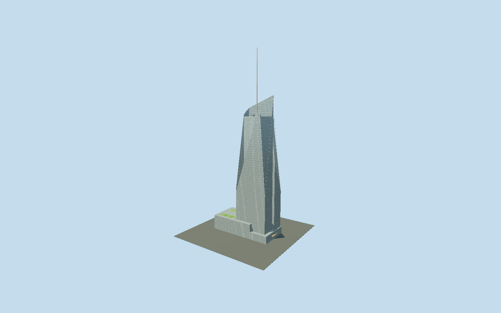

# Bank of America Tower

Asymmetric crystalline tower, offset365.8m pipe spire, planted podium, bamboo entry canopy with three openings, retained neo-Georgian theatre frontage.

## Evidence and reconstruction

Published dimensions and reconstructed details are separated in spec.json. Primary references:

- [Reference](https://www.durst.org/properties/one-bryant-park)
- [Reference](https://www.durst.org/pdf/obp.pdf)
- [Reference](https://www.skyscrapercenter.com/building/bank-of-america-tower/291)
- [Reference](https://www.openstreetmap.org/way/86121621)
- [Reference](https://s-media.nyc.gov/agencies/lpc/lp/1357.pdf)
- [Reference](https://rerecord.library.columbia.edu/pdf_files/ldpd_7031148_058_57.pdf)
- [Reference](https://www.roundabouttheatre.org/theatre/stephen-sondheim-theatre/)
- [Reference](https://michaelminn.net/newyork/theatres/broadway-theatres/henry-millers-theatre/index.html)

No third-party geometry, photograph or bitmap texture is embedded. Shared surface graphs come from the central library; vertex tints carry model colors. Glazing uses PBR materials; transparent surfaces are declared per model.

## Model and axes

17,261 triangles; 42,405 vertices; 8 material groups; 1,738,288 bytes. Native bounds: -65.497, 0.000, -33.200 to 68.560, 365.800, 30.857. Source hash: `sha256:646fdb37439b9e6b708a91214f03919d595d3b4c6f42202adebcbeced99e4225`.

{"up":"+Y","longitudinal":"+X towardSixthAvenue","front":"-Z retained theatre toward43rdStreet; tower canopy+X","origin":"Ground-contact center of mapped whole block"}

The geographic proposal uses exact-QID OpenStreetMap evidence. Map-derived orientation and estimated architectural details require real-site visual review; preview eligibility is distinct from geographic/fidelity approval. Map attribution: © OpenStreetMap contributors, ODbL-1.0.

## Reproduce

Run `node packages/worldgen/scripts/generate-signature-towers.mjs --ids=bank_of_america_tower` (or add `--check`). The generator preserves manually edited masters by checking their baseline hashes. Import through the standard authored-model workflow with optimization disabled; then capture all QA cameras, including shared-surface views.

## Pending work

- Complete mapped tower/podium exterior plus retained theatre facade; original19475-triangle master recipe preserved.365.8m architectural/tip and234.5m occupied data followCVU,55floors. Owner/architect2010 versusCVU2009 completion difference recorded. Map15/30/236/240/245/250/257/262/279m subdivisions and all wedge slopes are approximate.4.4196m typical floor and pipe diameters1.778/.6604m follow engineering publication; exposed spire above279m is86.8m, internal reconstructed pipe begins246m. Actual owner whole exterior/green roof and architect canopy/facade photos inspected. Bamboo-clad entry canopy replaces unsupported glass/columns; three true roof openings retained at every level but height8.8m/projection3.3m/opening positions and width21m are reconstructed, not measured solar alignment. Low sedum beds replace unsupported roof trees; exact planting/rail layout unmeasured. Theatre five central bays, two blind upper arches, flanking urn niches/pediments and cornice follow historical LPC designationdescription/photo. Retained facade dimensions and placements reconstructed; current signage, figure reliefs, theatre interior and underground auditorium omitted. Shared256px Flemishbrick/wood/concrete/granite/paintedmetal graphs with tint approximate original materials; bamboo uses generic wood grain, frit uses opaque palette glass and broad frame bands. No copied photo textures or embedded images. True grade, night illumination and physical-device timings unmeasured.

This bundle follows the medium-fi standard. Medium-fi appearance and geographic fit are reviewed separately. Hash-bound visual acceptance is recorded separately after capture inspection.
