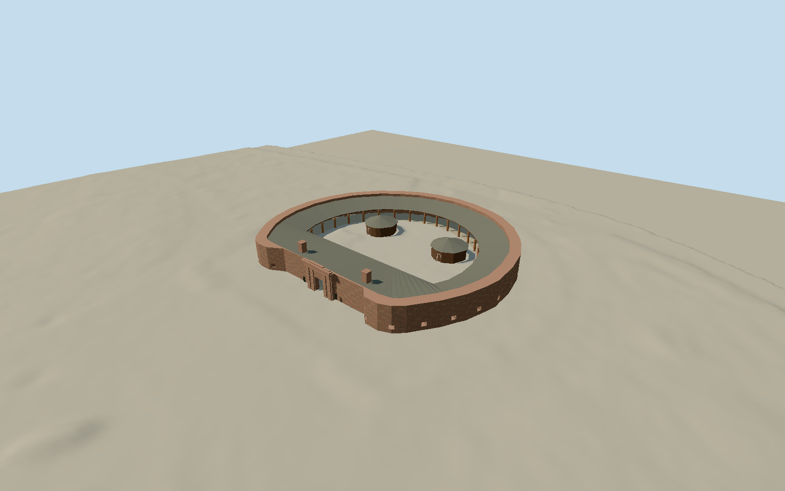

# Castle Clinton

Current hollow D-shaped varied brownstone fort with thick separate outer wall, real front/rear passageways and28 interpreted barred gunports, broad gray-shingle covered perimeter walks, curved brick-pier porch and straight pale-wood colonnade/restored quarters. Filled upper gateway arch, rusticated four-pilaster surround, layered cornice/two chimneys and two dark polygonal wood kiosks. Open courtyard and mapped roof opening remain distinct from wall thickness; no aquarium dome.

Authoring state: **review-in-qa.json**. Current completion evidence is in [qa.json](qa.json) and the [local 100 ledger](../../../../qualla-structures/batches/PROGRESS.md).

- [Castle Clinton: The Fort That Became America's Front Door](https://qualla.com/castle-clinton/)

Native7.8m root height is not a uniform ring extrusion. Outer wall and current portal/casemate/quarter heights must be reconciled individually against photographs.

Native court hole follows roof/open-court boundary; it is not the full depth of8ft-thick masonry. Outer plan/roof controls remain distinct from own wall inset and porch supports.

NPS92ft inner radius and8ft wall are approximate structural controls; exact endpoint interpretation must be reconciled with native outer diameter~61m.11ft historic sally-port door does not mean the entire ornamental gateway is11ft tall.

Accepted hero aerial is dated1959–1967 and lacks later restored portico/quarters/kiosks. Use only as historical outer-plan comparison; date2004 is not acquisition date.

Independent original USGS F32 export and all66049 values verified before geometry;2.5969m dry court datum. No terrain fitting/flattening or survey-datum transformation. Resampled1m spacing is not survey accuracy; hidden foundations and default host compatibility remain unverified.

Current6m wall,7.18m portal/7.29m chimneys,3.55..5.25m attached gray roofs and4.7m kiosk roofs are photographic estimates, not measured endpoints. Inner main-body inset follows primary8ft control; native court hole marks roof edge, not masonry thickness.28 historical gunport positions are evenly interpreted along the surviving curved ring, with small adjustments near the mapped rear gate; exact present count/positions, inner buttress spacing and individual infills remain approximate.

Native outer/roof opening and kiosk plans are retained. Main and rear passages follow actual mapped tunnel paths; portal upper semicircle is filled stone above actual rectangular opening. Fine lettering/plaques and fixtures are simplified without copied text/heraldry.

Own courtyard paving follows held-fixed independent bare-earth grade with a thin clearance, without changing original field. Coarse detail levels approximate floor grade; hidden wall-ground interpolation, source2013 project vs later paving changes, exact thresholds and default coarse Earth host compatibility remain unverified.

Eleven actual local originals constrain exterior. Historical1959–1967 aerial supplies comparison only; current restored portico/quarters/kiosks follow2010–2019 photos. City, vegetation, people, portable signs/barriers, cannon displays, flag and interiors excluded.

Build: `node packages/worldgen/scripts/generate-authored-places.mjs --ids=castle_clinton`. Add `--check` to verify exact regeneration. 37203 triangles; 7 materials; no embedded photographs.
