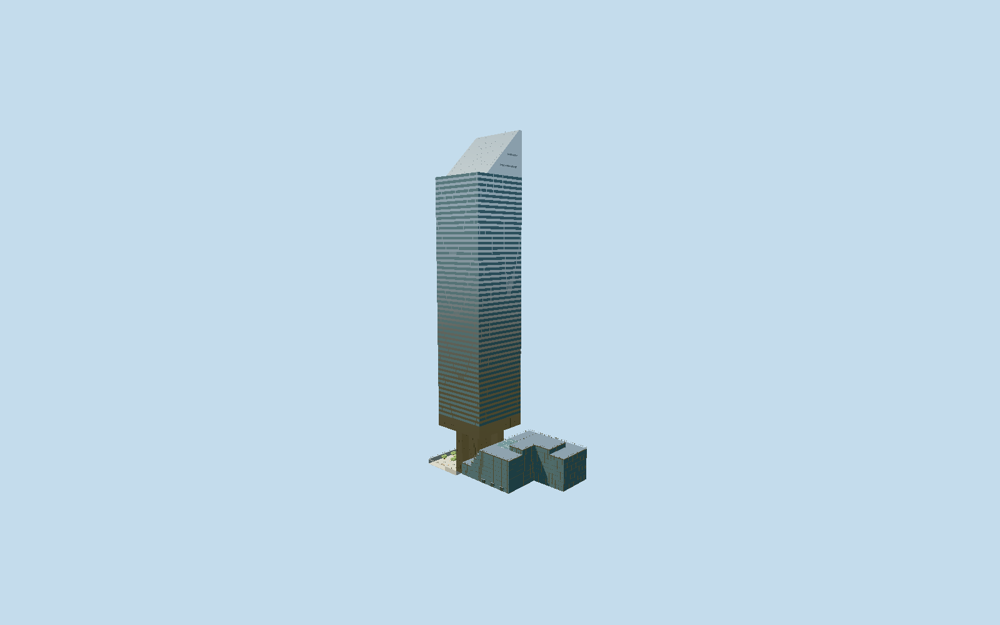

# Citigroup Center

Detailed original Citicorp/601 Lexington exterior with four face-centered supercolumns and octagonal core, silver ribbon shaft, south-facing45-degree roof, separately modeled Saint Peters Church, stepped market and current sunken plaza.

## Evidence and reconstruction

Published dimensions and reconstructed details are separated in spec.json. Primary references:

- [Reference](https://s-media.nyc.gov/agencies/lpc/lp/2582.pdf)
- [Reference](https://www.nyc.gov/assets/lpc/downloads/pdf/presentation-materials/20190716/601-Lexington-Avenue.pdf)
- [Reference](https://www.gensler.com/blog/office-to-everything-a-new-path-for-revitalizing-downtowns)
- [Reference](https://www.bxp.com/properties/601-lexington-avenue)
- [Reference](https://www.saintpeters.org/the-space)
- [Reference](https://www.openstreetmap.org/way/164105516)

No third-party geometry, photograph or bitmap texture is embedded. Shared surface graphs come from the central library; vertex tints carry model colors. Glazing uses PBR materials; transparent surfaces are declared per model.

## Model and axes

39,331 triangles; 97,625 vertices; 4 material groups; 3,989,204 bytes. Native bounds: -70.660, -4.010, -31.780 to 54.573, 280.592, 31.780. Source hash: `sha256:332fd48ef49022b5d7c8d160ff259a431ccf1fbcc0ad95733ff33397805de1f1`.

{"up":"+Y","longAxis":"+X towardThird Avenue/east-southeast","shortAxis":"+Z toward53rd Street/south-southwest"}

Fresh2026-10-10 exact-Q391243 whole-complex way164105516 and23separately mapped church/tower/support/core/market parts match every original raw geometry exactly. Original anchor[-73.969900246,40.758316] and heading-0.515233220358 remain unchanged; projection residual under1mm against rounded native outlines. The independently labeled2016LPC designation map and2019LPC plans sign the complex: native+X ThirdAvenue/east-southeast, -X Lexington/west-northwest, +Z53rdStreet/south-southwest, -Z54thStreet/north-northeast. Church stands northwest, plaza southwest; the45degree roof descends toward+Z/south as described byLPC. The tower roof projection at35m is never claimed as a solid ground footprint. Four24ft/7.3152m supports stay centered on each face and the octagonal core stays separate. GroundY0 is an approximate53rdStreet entry datum; lower plaza-12ft6in/-3.81m followsLPC page10. Upper plaza-8ft9in/-2.667m and its stair landing are approximated separately; curb gradients, doors, exact market terrace/skylight planes, facade phase and furniture are photographic reconstructions. Accept1m principal envelope/1degree frame allowance, not a doorway/terrain survey. Ground cutout is confined to the southwest plaza; no footprint replacement, subterranean food-hall interior, adjacent880ThirdAvenue or public street included.

## Reproduce

Run `node packages/worldgen/scripts/generate-signature-towers.mjs --ids=citigroup_center` (or add `--check`). The generator preserves manually edited masters by checking their baseline hashes. Import through the standard authored-model workflow with optimization disabled; then capture all QA cameras, including shared-surface views.

## Pending work

- Unchanged buildCiticorp detailed original master retains369848triangles/32574548bytes. Reviewed source keeps the raised rectangular shaft/open underside, four face-centered24ft supports, separate octagonal core,50reconstructed silver/vision ribbon courses,45degree south roof with flat ends and northern recess/two east mechanical slots/four antennas, two granite SaintPetersChurch wedge roofs/skylight/front entry and cross, stepped market/three gabled skylights/terrace guards/planters, lower southwest plaza with closed walls/stairs/current furnishings and food-hall exterior glazing. Fine panel and stone joint tubes and pane-cell frames become continuous planes and optional flat strips; near roof panels use sparse flat seams, soffit tiny seams omitted. Skyline preserves full tower, four supports/core/open corners, church, all stepped market blocks/skylights and plaza/decks/coarse stairs with ten-row ribbons, flat guards and four flat antenna fins. District restores four-row rhythm, coarse glazing frames and porch enclosures/stairs; street restores50ribbons,4module frames,23stairs/handrails, coarse trees/benches/tables/lamps; near adds1module facade/panel seams, 1.5m railposts/trees and furniture details. Two shared stainless/granite graphs serve cladding/stone with rebalanced colors; wood furniture and foliage use tinted granite as coarse approximations, glass/recess one opaque vision palette and doors separate translucent palette, four near groups. Raw map rings remain preserved; collinear native plan vertices within0.025m are omitted from derivatives. District uses flat double-sided guard sheets, street6m railposts, near1.5m railposts; the plaza guard intentionally remains open across the main stair. LPC completed1978 and mapped/legacy1977 dates differ and are retained as distinct source statements. Original50ribbon count,35m underside,242m roof spring and intermediate church/market/support heights are reconstructions from approximate map parts and photographs, not59floor survey. Unknown joint/hardware/furniture positions, upper-plaza landing and curb slopes remain approximated. Physical-device/dense-city timings and global geometry error bounds are unmeasured.

This bundle follows the medium-fi standard. Medium-fi appearance and geographic fit are reviewed separately. Hash-bound visual acceptance is recorded separately after capture inspection.
