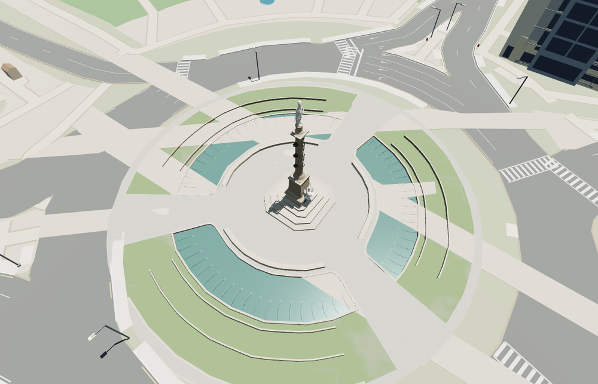

# Columbus Circle

Columbus Circle in Manhattan with three mapped fountain arcs, the granite pedestrian island and the rostral monument. The marble summit, the Genius of Discovery, the eagle and the bronze reliefs remain distinct across the detail tiers.

The 19,874-triangle source rebuilds byte for byte. Skyline, district, street and close-up use 955, 3,620, 10,442, 17,864 triangles. The first two tiers total 412,660 bytes. Six GLBs validated and 38 current views were inspected.

All four tiers pass 12 pool, 12 step, six ship-prow and three spoke-join probes. The statue reaches 23.16 m above the site datum. The viewer retains 117 independent building records and 215 mapped transportation parts. Below-ground station geometry remains in the map inputs. Failed loading restores the seven original monument parts and three native basin surfaces.

The monument proportions combine seven mapped components with the exterior photographs. The statue height follows the roughly 76-foot total, while the mapped procedural envelope is 25 m. Sculpture faces, drapery and reliefs are medium-fi reconstructions. The fountains use fixed water levels and static jet arcs. Paving follows the standard terrain and retains native street, footway and planting data. Physical-device timings are unmeasured.

Rebuild with `node packages/worldgen/scripts/generate-columbus-circle.mjs`. Append `--check` to compare exact bytes. Use `--ids=columbus_circle` for targeted import, LOD, placement and readiness.
