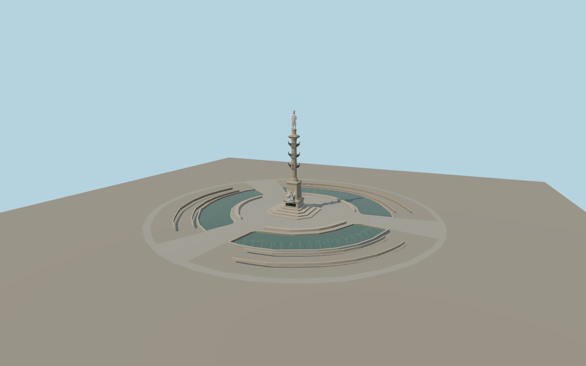

# Columbus Circle

Columbus Circle in Manhattan with three mapped fountain arcs, the granite pedestrian island and the rostral monument. The marble summit, the Genius of Discovery, the eagle and the bronze reliefs remain distinct across the detail tiers.

Run `node packages/worldgen/scripts/generate-columbus-circle.mjs` to rebuild the source master. Append `--check` to compare the exact bytes. Use `--ids=columbus_circle` for targeted import, LOD generation and placement.

The monument proportions combine seven mapped components with the exterior photographs. The statue height follows the roughly 76-foot total, while the mapped procedural envelope is 25 m. Sculpture faces, drapery and reliefs are medium-fi reconstructions.

The fountains use fixed water levels and static jet arcs. Paving follows the standard terrain and retains native street, footway and planting data.

Original geometry follows the repository license. Map data is © OpenStreetMap contributors under ODbL-1.0 via Protomaps. Terrain samples are described in terrain-grid.json. Ordinary pictures stay local and are not redistributed or used as textures. Current acceptance:qa.json.
