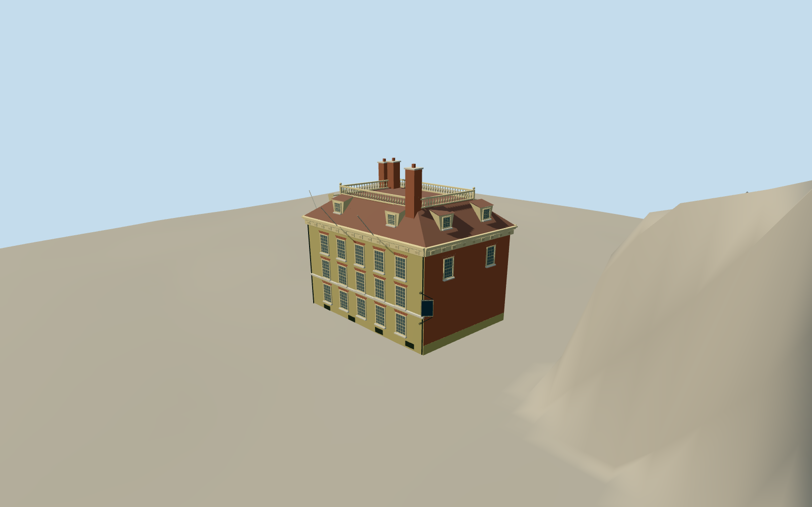

# Fraunces Tavern

Restored three-story corner tavern with red Pearl Street and buff Broad Street brick, twelve-over-twelve sash, columned entry, paneled cornice, attic dormers, truncated roof platform and balustrade.

Authoring state: **review-in-qa.json**. Current completion evidence is in [qa.json](qa.json) and the [local 100 ledger](../../../../qualla-structures/batches/PROGRESS.md).

- [Fraunces Tavern](https://qualla.com/fraunces-tavern/)

Original medium-fi exterior of the restored 54 Pearl Street corner building, informed by individually inspected Qualla 2010/2014 photographs and supplemental details plus official city architectural descriptions. Not a survey or exact 1783 reconstruction.

101 Broad Street, 58 Pearl Street, other museum buildings, interiors and the narrow mapped rear connector are excluded. Scope clipping is an explicit authoring boundary.

Mapped 14.6 m height is only an approximate roof/balustrade control; chimneys rise above it. Vertical dimensions, hidden roof surfaces and service-side windows remain interpretations.

Twelve-over-twelve sash, jack arches, paneled cornice and roof balusters are simplified geometry. The standard shared brick surface approximates the photographed Flemish bond without the pronounced repeat seam of the current Flemish graph. Sign portrait and lettering, flags, interior details and photograph pixels are not reproduced.

Independent terrain remains unchanged with foundation below the sidewalk datum. Exact contact can differ with another host DEM.

Build: `node packages/worldgen/scripts/generate-authored-places.mjs --ids=fraunces_tavern`. Add `--check` to verify exact regeneration. 19895 triangles; 6 materials; no embedded photographs.
