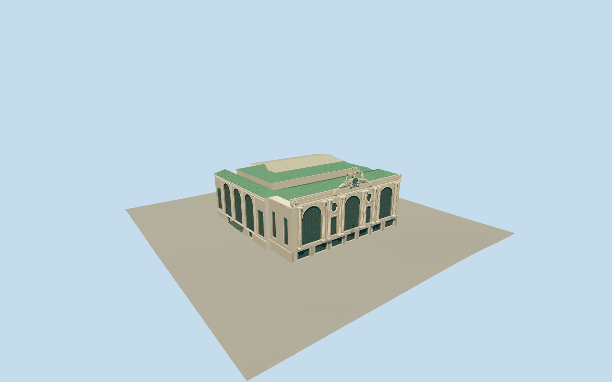

# Grand Central Terminal

Own Beaux-Arts limestone terminal: three great arched gridded south windows, ten fluted columns, oval windows/garlands, granite retail entrances, attic/dentilled cornice/cartouches, Tiffany-style coloured exterior clock, original simplified Mercury/eagle/Hercules/Minerva group and bronze Vanderbilt figure, green copper front/side hips, raised light main-concourse roof and open internal area-way. Surrounding viaduct, towers, platforms and interiors excluded.

Authoring state: **review-in-qa.json**. Current completion evidence is in [qa.json](qa.json) and the [local 100 ledger](../../../../qualla-structures/batches/PROGRESS.md).

- [Grand Central Terminal](https://qualla.com/grand-central-terminal/)

New physical exterior clock is based only on exact native Highsmith2008photographer-public-domain detail after Qualla-first41paths. Blue field,12burgundy oval medallions,radial white Roman numerals,gold rings/spokes and raised hands built; exact craft,dial dimensions,ornament,time and current patina remain medium-fi estimates. Full fixed terminal exterior still awaits broader cleared public-domain coverage. Earlier image controls are historical and excluded.

Own envelope uses official NYC BIN1035381 polygon91.584x87.720m, south facade85.807m; this agrees historical301ft overall width and excludes broader mapped viaduct margins. Local2019/2012 photographs, primary operator2010 section and aerial control proportions. Facade/detail/roof heights, window profiles and original simplified sculptures remain estimates, not measured survey/scans.

Integral clock/sculpture group, bronze Vanderbilt, original monumental windows and own roof masses retained. Side/rear opening placements and hidden area-way equipment are approximate. Neighbouring MetLife/Hyatt/Graybar/One Vanderbilt, road viaduct/bridge, tracks/interiors, flags, shop signage/awnings and street furniture excluded. No reference photographic pixels or plan pages redistributed.

Native independent terrain retained unchanged; geographic activation requires current source contact review. Footprint replacement disabled.

Build: `node packages/worldgen/scripts/generate-authored-places.mjs --ids=grand_central_terminal`. Add `--check` to verify exact regeneration. 63788 triangles; 7 materials; no embedded photographs.
