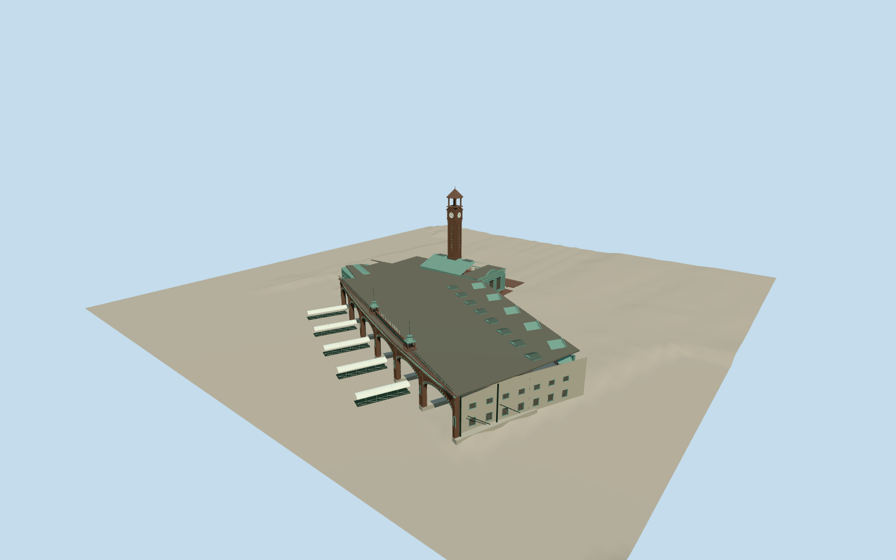

# Hoboken Terminal

Joined surviving copper ferry/rail terminal, six real deep open elliptical ferry-slip arches with structural piers/columns, rear concourse, five gabled plaza pavilions/canopy, three-window limestone/copper waiting-room facade and high skylit roof, low south rooms/former restaurant, reconstructed brown four-face clock tower with open bell lantern, green roof belvederes, raised Lackawanna signs, eight roof monitors and five white curved gangways. Western platform/train sheds, neighboring buildings, boats and interiors excluded.

Authoring state: **review-in-qa.json**. Current completion evidence is in [qa.json](qa.json) and the [local 100 ledger](../../../../qualla-structures/batches/PROGRESS.md).

- [Hoboken Terminal](https://qualla.com/hoboken-terminal/)

New reconstructed-tower clock cases/radial Roman numerals/marks/hands,stepped hoods/cornices,eight pilaster mouldings/eight brackets/sixteen original simplified scrolls use exact local PedroXing2012self-CC0native and two exact named self-CC0tower originals. Full fixed joined terminal/ferry/rail scope retained; broader cleared facade/roof/gangway coverage still pending. Earlier attribution/private imagery controls are historical and excluded. Fine craft,lantern/roof proportions,current condition and hidden surfaces remain medium-fi estimates.

Selected2010/2015 surviving exterior and focused2011/2012 originals, primary site/floor plans, mapped parts and aerial. Own joined terminal differentiated from western platform sheds/baggage/Pullman buildings. Exact ornamental profiles, window layouts/roof heights and buried/marine pile depths remain estimates, not survey/scans.

Replica clock tower225ft/68.58m follows reconstruction designer STV, consistent with historic nomination; operator203/230ft historical statements conflict. Four12ft dials follow operator reconstruction description. Tower is above main waiting room per primary description; plain north end, five plaza pavilions and six open slips remain distinct.

Gangways fixed representative poses without boats, detached pontoons/dock equipment or tide animation. Interiors, western train-shed/platform roofs, neighboring baggage/YMCA/Pullman buildings, plaza/streets, flags/temporary signs/construction excluded. No reference pixels redistributed.

Independent USGS1m bare-earth terrain retained unchanged; hydroflattened water is not seabed/tide survey. Marine pile embedment and other host terrain compatibility unverified. Footprint replacement disabled.

Build: `node packages/worldgen/scripts/generate-authored-places.mjs --ids=hoboken_terminal`. Add `--check` to verify exact regeneration. 63889 triangles; 8 materials; no embedded photographs.
