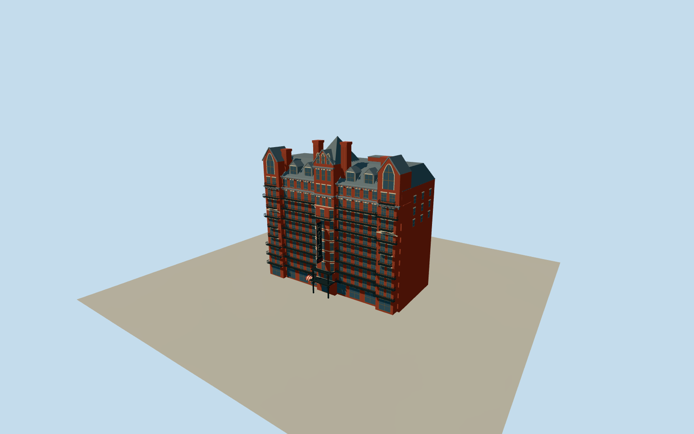

# Hotel Chelsea

Restored red-brick West 23rd Street exterior with eight varied iron balcony tiers, three projecting sections, pointed end gables, four dormers, four massive chimneys and tall central roof.

Authoring state: **review-in-qa.json**. Current completion evidence is in [qa.json](qa.json) and the [local 100 ledger](../../../../qualla-structures/batches/PROGRESS.md).

- [Hotel Chelsea: Where Art Checked In and Never Left](https://qualla.com/hotel-chelsea/)

Full medium-fi exterior reviewed against the cleared Qualla sign original, exact1936Abbott WPA balcony photograph and primary NYC landmark description of the roof, chimneys and end gables. No whole-building photographic survey claimed.

Earlier attribution-licensed facade/ironwork photographs are excluded from the active review. Retained architecture now compared with independent public-domain imagery and primary factual architectural descriptions.

Mapped height 52.5 m provides a coarse upper roof control. Intermediate levels, roof slopes, rear/service openings and exact balcony panel spacing remain photographic approximations.

2025 public-domain night view resolves vertically stacked cream HOTEL and a red horizontal CHELSEA footer. Original simplified letter outlines, sign dimensions, thickness, concealed mounts and unlit appearance remain estimates. No photo pixels or measured neon emission are embedded.

The hotel parcel only; adjacent buildings, interiors and precise rooftop spa/garden fit-out are excluded. Hidden roof service enclosure and side/rear openings are conservative interpretations.

Independent terrain is preserved unchanged, with foundation below the central sidewalk datum. Exact contact with another host DEM remains uncertain.

Build: `node packages/worldgen/scripts/generate-authored-places.mjs --ids=hotel_chelsea`. Add `--check` to verify exact regeneration. 44745 triangles; 5 materials; no embedded photographs.
