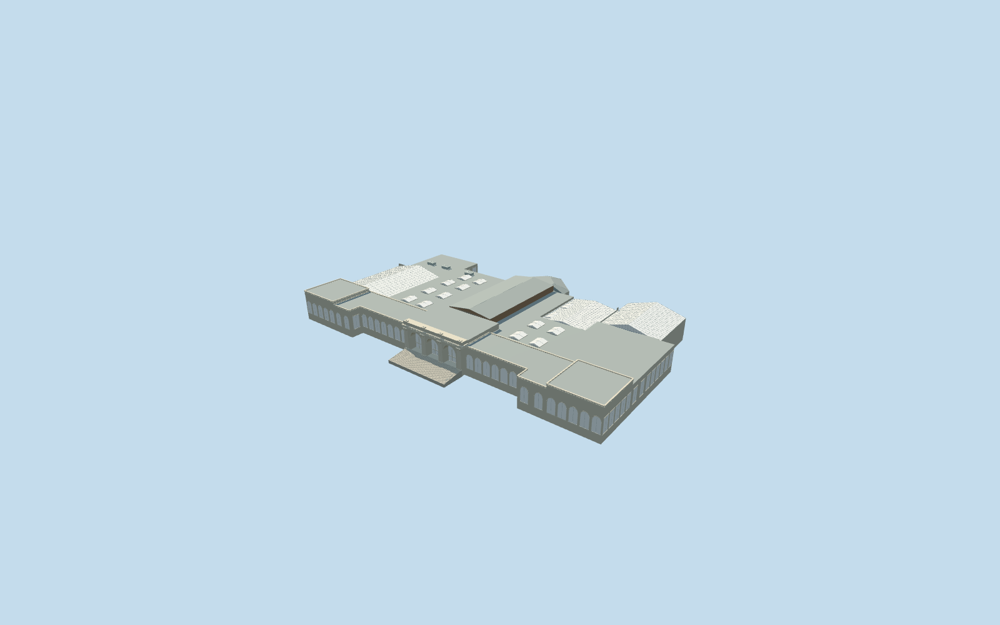
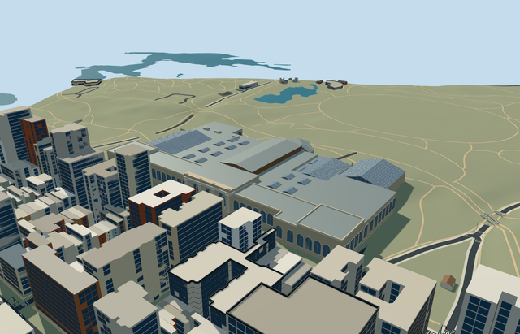

# metropolitan_museum_of_art — Metropolitan Museum of Art

Reviewed2026-10-21 in one continuous author/build/inspect/fix pass.

## Appearance

Inspected all48 current source/shared/medium-fi/native frames during one author/build/inspect/fix pass. Complete mapped Metropolitan Museum complex: three recessed entrance arches/eight paired fluted Corinthian columns/deep entablature and attic, broad front steps, classical wings/end pavilions, varied gallery roofs/rooflights, central historic core, rear polygonal Lehman hip and large glazed Rockefeller/Dendur/American Wing enclosures. Corrected the hidden park glazing, extra automatic arches inside entrance bays, rooflight end caps and terrain opening at recessed corners before acceptance. No temporary banners/copied inscriptions/artwork or furnished galleries.

## Shared surfaces and browser budgets

Six existing256px graphs: stone_limestone, stone_limestone_raw, brick, metal_painted, metal_standing_seam and window_grid. Six merged near runtime draws/one skyline draw, no new graph/private atlas/embedded images. Metric UVs, linear palette tints, separate POSITION/NORMAL streams and equal CPU/GPU accounting. Each graph read once in shared/native contexts. Opaque shared glazing approximates architectural reflections; portable image-free fallback panes are pale and do not demonstrate shared-texture appearance.

| Level | Triangles | Bytes | Draws |
| --- | ---: | ---: | ---: |
| skyline | 579 | 52864 | 1 |
| district | 3189 | 308528 | 6 |
| street | 14633 | 1391064 | 6 |
| closeup | 22509 | 2156712 | 6 |

Four authored browser levels: 579/3189/14633/22509triangles, initial skyline plus district 361392bytes. Entrance/roof/wing silhouette retained far; rounded arches, paired columns, mullions, rooflights and coarse ornament appear near. All limits pass. Physical ordinary-laptop/phone/tablet and dense-city timing measurements remain pending.

## Approximate native placement

Retained Q160236/relation3698894 and named native museum parent52776561832142 establish identity. Current standard PMTiles supplies a single39-point approximately305.7x189.7m outer footprint and unqualified26.8m height; it does not supply separate wing footprints. The retained undirected axis1.066209682834rad and ordinary photographs resolve positive internalX uptown/northeast and positiveZ toward Fifth Avenue. Anchor[-73.963549859,40.779486387]/world heading0/native east-south; wing subdivisions, roof forms and facade inventory are picture-led allocations clipped to the actual outer footprint, not mapped part controls. Only native museum parent52776561832142 is replaced. All483 independent resident records of484 originals and all988 independent wider records of989 remain unchanged. Original6m grid/native roads/484013.02426837385square metres water unchanged. Six actual PMTiles13/14/15 cases pass, including both detailed museum fragments. Detailed replacement uses99.5percent coverage; generalized tiles use bounded area clipping. Ground opening stays inside occupied geometry at recessed footprint corners. Failure retains484 originals; every LOD unload restores terrain/water and leaves zero live model geometry. Original standard6m Mapzen grid/roads/water and independent native buildings remain unchanged. Owned boundary samples span-3.6950338398745046..5.046267405826558m relative to anchor. Ground opening is limited to occupied museum and front stair surfaces present at every LOD; no Central Park precinct slab or flattening. Foundations extend from original boundary minimum into occupied bodies; coarse DEM at the park margins remains approximate. Detailed replacement uses99.5percent coverage, generalized tiles bounded area clipping. Failure retains original context; unloading restores terrain/water and disposes model geometry.

## Limits

Three ordinary pictures actually viewed: official2001 aerial,2025 Fifth Avenue entrance photograph and undated park-side travel photograph. Pictures inform visible form only/no copied pixels. Existing photographic configuration; future Tang wing, temporary exhibition art, collections/furnished rooms and hidden plant excluded. No bespoke archive/survey/terrain research. Native26.8m building height/28m elevation tags have unqualified datums. Working plaza floor-1.5093119261653207m relative to original anchor28.259306309605005m, entry3m above that plaza, classical front cornices22.4..26.8m, central historic roof30m, modern glazed wings18..26m and rear Lehman roof23m. These varied architectural heights, bays/columns/steps, rooflight and mullion inventories, ornament and facing are approximate visual allocations from ordinary photographs, not a survey or access/engineering certification. Shared opaque glazing approximates reflections and does not expose furnished galleries.

## Selected checks

Six Khronos files: zero errors/warnings. 647 actual geometry/material/contact checks, 48 current inspected views, six native map-level cases. Selected source/import/placement/strict medium-fi/scene/lint checks pass. Sim30 hash2c73e3eafa35a2f8294bb5c43747a4486149f41fd675e32b2c361bfd977a1a1a.

Source sha256:cefb98cd5ac443ee51d660c6e38fc4b46968594fec5be3ee439d51a8d8fb8c4e

Runtime sha256:76492d6a0dffab5596f0397f556a0ad1589bb5ae2226cc15c3f657ffea6be188

Input sha256:012ae91d75f5e9935953d52f2056e2639c299e3499645b1fbadd3cd6a82ae88b

Rebuild: node packages/worldgen/scripts/generate-additional-landmarks.mjs --ids=metropolitan_museum_of_art; node packages/worldgen/scripts/import-structure-models.mjs --ids=metropolitan_museum_of_art; node packages/tooling/scripts/generate-landmark-lods.mjs --ids=metropolitan_museum_of_art --force.

## Ordinary picture references

https://www.metmuseum.org/perspectives/history-of-the-met — https://cdn.sanity.io/images/cctd4ker/production/12501886e914eb64fdcf9d1bba0f12bcd6d14183-720x572.jpg; The Metropolitan Museum of Art; 2001 aerial, identified by the official caption; Copyright reference, viewed only. Viewed only/no copied pixels.

https://commons.wikimedia.org/wiki/File:Metropolitan_Museum_of_Art_main_building,_5th_Avenue_entrance_04.jpg — https://thumb.wikimedia.org/wikipedia/commons/thumb/1/11/Metropolitan_Museum_of_Art_main_building%2C_5th_Avenue_entrance_04.jpg/960px-Metropolitan_Museum_of_Art_main_building%2C_5th_Avenue_entrance_04.jpg; TheCatalyst31; 2025-10-16; CC-BY-SA-4.0. Viewed only/no copied pixels.

https://www.mountainsoftravelphotos.com/USA%20-%20New%20York%20City/07%20Central%20Park/slides/31B%20The%20Back%20Of%20The%20Metropolitan%20Museum%20Of%20Art%20From%20Central%20Park%20East%20Side%2082%20St.html — https://www.mountainsoftravelphotos.com/USA%20-%20New%20York%20City/07%20Central%20Park/slides/31B%20The%20Back%20Of%20The%20Metropolitan%20Museum%20Of%20Art%20From%20Central%20Park%20East%20Side%2082%20St.jpg; Mountains of Travel Photos; Undated ordinary travel photograph; Copyright reference, viewed only. Viewed only/no copied pixels.
