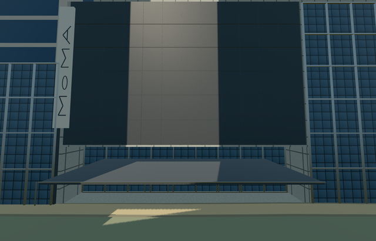

# museum_of_modern_art — Museum of Modern Art

Reviewed 2026-10-22. **Complete as a medium-fi mapped exterior with approximate native fit.**

## Built and inspected

Specific MoMA mapped main museum and six integral parts: stepped pale gallery masses, mapped west service block, charcoal panelled 53rd Street slab, actual recessed glazed lobby and open soffit, thin knife-edge canopy, pale identity blade with original geometric MoMA glyphs, garden-facing mullioned glazing/terrace, and low west gallery-front skin with a schematic blade-stair hint. Independent Museum Tower and 53W53 upper buildings stay native. Two ordinary street/garden pictures and standard PMTiles guided one continuous pass. Added the missing skyline soffit after a concrete ray-test failure, then refreshed current captures. No artwork, copied signs/photos, garden sculptures or furnished interiors.

## Shared surfaces and browser LODs

Five existing 256 px graphs across seven roles: concrete panels/plain concrete, painted metal shared by charcoal surfaces and pale identity blade, beadblasted stainless frames/rails, and storefront glass. Opaque shared glazing approximates reflections without transparent-interior sorting cost. No private atlas, new graph or embedded image. Each requested graph loads once; all model geometry is released on unload. Six textured draws near, one skyline draw.

| Level | Triangles | Bytes | Draws |
| --- | ---: | ---: | ---: |
| skyline | 347 | 27,448 | 1 |
| district | 1,358 | 120,536 | 6 |
| street | 8,356 | 751,072 | 6 |
| closeup | 8,560 | 770,660 | 6 |

Four authored LODs: 347 / 1,358 / 8,356 / 8,560 triangles, all inside medium-fi budgets. Initial skyline plus district 147,984 bytes; close-up 770,660 bytes. Separate POSITION/NORMAL buffer views and matching CPU/GPU accounting. 45 current inspected source/shared/lighting/LOD/native frames and 101 mesh/contact probes across six GLBs. Physical laptop/phone/tablet and dense-city timings remain pending. Synthetic flat fixtures do not approve native grade.

## Geographic placement

Approximate native exterior fit accepted on the unchanged standard 201 × 201 / 6 m terrain. Exact named Q188740/way278346578 version 43 plus five gallery parts and relation 2100751 version 5 service part 148251196 establish seven owned records. Internal axes follow 53rd Street; heading 0 with orientation baked into model east/south coordinates. 19 actual overlapping PMTiles levels 13/14/15 cases pass. Successful placement replaces seven records and retains all 2,918 independent resident and all 3,543 wider independent records, including Museum Tower and 53W53. Failure retains all 2,925 resident inputs. Original roads/water 19,202 m²/grid remain unchanged; uncovered sidewalk provider stays intact and modelWorldY is approximately 0. Each unload restores ground/water and zero live geometries. Entry floor is 0.067 m above front-sidewalk datum, with modest edge footing exposure. Exact thresholds, accessibility and unqualified map height controls remain unverified.

## Fidelity and limits

Medium-fi exterior completed using real mapped silhouette and source pictures. Mapped 25/35/74.8 m heights are retained as unqualified controls, not a certified height survey; the 74.8 m service mass is not independently height-verified by the limited pictures. Hidden roofs/rooms, window inventory and facade details are reconstructions. West extension is a closed shallow museum facade skin on the independent 53W53 podium, with a schematic blade-stair hint; tower structure, furnished interiors and contemporary art are excluded. Historical 2006 garden picture informs surviving facade vocabulary rather than certifying current garden furnishings. No bespoke terrain or private texture.

## Targeted checks

Six GLBs, zero Khronos errors/warnings; 101 mesh/contact probes; 19 map-overlap cases; 45 inspected frames. Selected generation/import/placement, strict medium-fi, scene/sim30 and lint checks pass. Sim30 sha256:d05a4dd59d6bcd20da2b41172bd53c3e9e78bf3eeba9f983f9fcbe822126d4fd. Current pins: [qa.json](qa.json). Editable controls: [map-frame.json](map-frame.json).

## Viewed references

- https://commons.wikimedia.org/wiki/File:Museum_of_Modern_Art_(MoMA)_(51395759113).jpg — Ajay Suresh; 2021-08-21; CC-BY-2.0. Viewed only, no copied pixels.

- https://commons.wikimedia.org/wiki/File:MOMAyard.JPG — Alsandro; 2006-10-14; CC-BY-2.5. Viewed only, no copied pixels.

- https://www.openstreetmap.org/way/278346578 — named MoMA/Q188740, version 43.

- https://www.openstreetmap.org/relation/2100751 — version 5; museum outline and part 148251196.

- https://www.openstreetmap.org/way/148251196 — version 6; unqualified 74.8m/concrete flat-roof control. © OpenStreetMap contributors,ODbL1.0.
