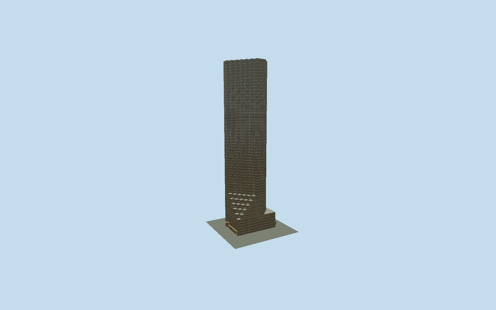

# Trump Tower

Complete Fifth Avenue bronze-glass sawtooth tower, six setback roofs, five planted upper terraces and mapped recessed entrance.

## Evidence and reconstruction

Published dimensions and reconstructed details are separated in spec.json. Primary references:

- [Reference](https://www.trumptowerny.com/)
- [Reference](https://www.skyscrapercenter.com/building/trump-tower/1611)
- [Reference](https://www.openstreetmap.org/way/159831418)
- [Reference](https://www.openstreetmap.org/way/265345374)

No third-party geometry, photograph or bitmap texture is embedded. Shared surface graphs come from the central library; vertex tints carry model colors. Glazing uses PBR materials; transparent surfaces are declared per model.

## Model and axes

19,198 triangles; 53,678 vertices; 5 material groups; 2,165,952 bytes. Native bounds: -27.400, 0.000, -17.848 to 26.352, 202.400, 17.848. Source hash: `sha256:00de91b3b671c742e55befb7994aa16fa356ccb6374486cf68953017f9e09fdb`.

{"up":"+Y","longitudinal":"+X along the mapped building long axis","front":"+Z","origin":"Ground-level center of exact-QID mapped footprint frame"}

The geographic proposal uses exact-QID OpenStreetMap evidence. Map-derived orientation and estimated architectural details require real-site visual review; preview eligibility is distinct from geographic/fidelity approval. Map attribution: © OpenStreetMap contributors, ODbL-1.0.

## Reproduce

Run `node packages/worldgen/scripts/generate-signature-towers.mjs --ids=N0152` (or add `--check`). The generator preserves manually edited masters by checking their baseline hashes. Import through the standard authored-model workflow with optimization disabled; then capture all QA cameras, including shared-surface views.

## Pending work

- Whole medium-fi exterior preserves the seven mapped footprints,202.4m sawtooth shaft, six stepped roofs and five upper planted terraces. Original19067-triangle recipe remains reproducible in Git. Reviewed source moves its five previously floating planters onto their corresponding mapped roof strips and replaces repeated storefront slabs at the independently mapped main entry with an original recessed bronze/gold portal. Entrance dimensions, glazing panels, concave spandrels, planting species and exact present hardware are reconstructed. CTBUH202.4m/58physical floors differs from owner marketing68; completion dates differ across owner1983/1984 and CTBUH1982 and are left attributed rather than invented into geometry. Owner brochure2019 plans and exterior photographs establish entrance/sawtooth identity, not a current hardware survey. Skyline keeps full silhouette with graph-mean colors; district simplifies vertical bars and combines spandrel rows; street keeps full bay strips; closeup keeps original concave spandrels and planted forms. Zero embedded images; canonical shared surfaces only. Interiors, branding, separate adjoining East57th public terrace, street clock and temporary security barriers are outside this exterior asset. Ground grade, night rendering and physical-device timing remain unmeasured.

This bundle follows the medium-fi standard. Medium-fi appearance and geographic fit are reviewed separately. Hash-bound visual acceptance is recorded separately after capture inspection.
