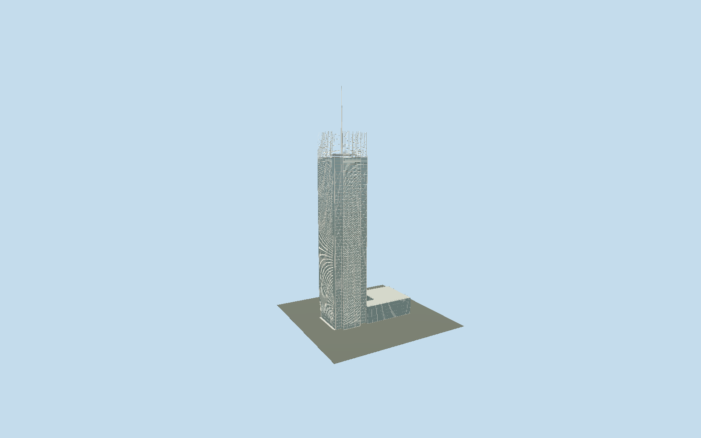

# New York Times Building

Whole New York Times parcel: cruciform glass shaft, white ceramic veil fading above the roof, exposed bracing,319m mast and open planted courtyard.

## Evidence and reconstruction

Published dimensions and reconstructed details are separated in spec.json. Primary references:

- [Reference](https://www.fondazionerenzopiano.org/en/project/the-new-york-times-building/)
- [Reference](https://www.thorntontomasetti.com/project/new-york-times-building)
- [Reference](https://www.hmwhitesa.com/site/assets/files/1212/the_new_york_times_building.pdf)
- [Reference](https://www.openstreetmap.org/relation/1860567)

No third-party geometry, photograph or bitmap texture is embedded. Shared surface graphs come from the central library; vertex tints carry model colors. Glazing uses PBR materials; transparent surfaces are declared per model.

## Model and axes

126,843 triangles; 237,935 vertices; 8 material groups; 10,092,224 bytes. Native bounds: -62.067, 0.000, -30.137 to 61.963, 319.000, 30.378. Source hash: `sha256:27f1515a5aac779df976e836c16bcb1a3f8cf401538c1689636f5ad0fdd161a1`.

{"up":"+Y","longitudinal":"+X along the mapped building long axis","front":"+Z","origin":"Ground-level center of exact-QID mapped footprint frame"}

The geographic proposal uses exact-QID OpenStreetMap evidence. Map-derived orientation and estimated architectural details require real-site visual review; preview eligibility is distinct from geographic/fidelity approval. Map attribution: © OpenStreetMap contributors, ODbL-1.0.

## Reproduce

Run `node packages/worldgen/scripts/generate-signature-towers.mjs --ids=N0155` (or add `--check`). The generator preserves manually edited masters by checking their baseline hashes. Import through the standard authored-model workflow with optimization disabled; then capture all QA cameras, including shared-surface views.

## Pending work

- Complete medium-fi parcel exterior retains the cruciform228m shaft, mapped western glass strip, eastern courtyard-preserving podium,260m fading ceramic screen and319m mast. Original125459-triangle recipe is preserved unchanged in Git. Reviewed source adds omitted western glass part260282089 and the courtyard grove of paper birches, sedge hillocks and timber path described and photographed by HMWhite. Nine reconstructed trees are an illustrative grove, not a counted vegetation survey; birch height15.24m follows published50ft. Original facade rods, brackets and structural beams remain in the detailed source. Ceramic rods use the existing shared tile_ceramic coating instead of granite; tile pattern is a generic shared coating, not a photographed rod. Screen bases follow mapped6m north/south and12m east/west min_height values; historic2007 photos are distinguished from current mapped state. Source facade pitch, rod count, specific support connections, door hardware and grove layout are reconstructed. Browser closeup replaces rod cylinders with double-sided strips of identical diameter and row schedule; street uses coarser strips and merged curtain-wall bars; district merges screen rods into wider low-frequency strips. Skyline keeps courtyard void, full shaft, fading crown supports and mast. No embedded textures. Interiors, tenant signage and temporary barriers omitted. Ground grade, night and physical-device performance unmeasured. Skyline uses5.2m-pitch screen strips with fading coverage and a2.6m geometric allowance; district/street bracket and brace plates replace small beam thicknesses. Generic shared ceramic coating tints are raised to pale white; glass remains a muted palette material.

This bundle follows the medium-fi standard. Medium-fi appearance and geographic fit are reviewed separately. Hash-bound visual acceptance is recorded separately after capture inspection.
