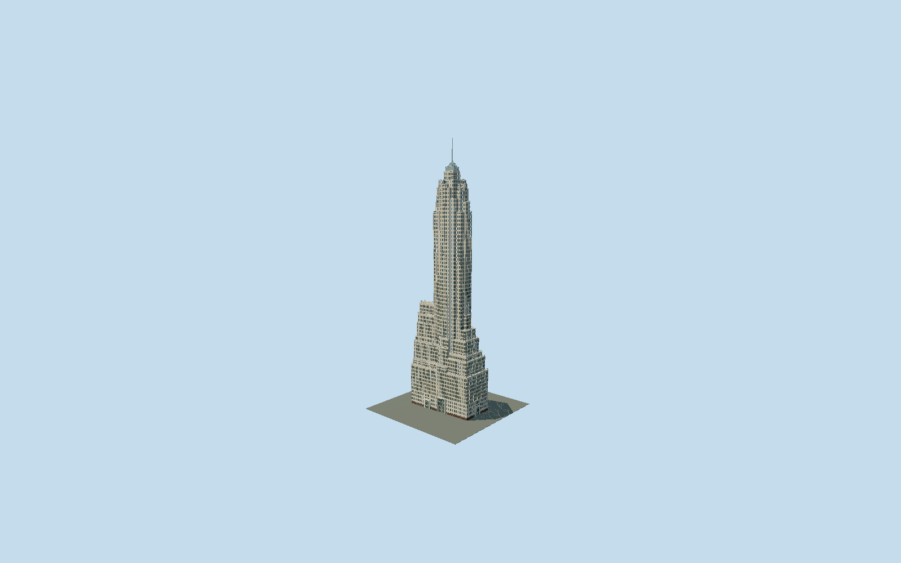

# 70 Pine Street

Complete medium-fi70Pine: asymmetric58-part Art Deco tower, five entrances, recessed brick sash bays, fan terrace railings, tiered lantern and stainless spire.

## Evidence and reconstruction

Published dimensions and reconstructed details are separated in spec.json. Primary references:

- [Reference](https://s-media.nyc.gov/agencies/lpc/lp/2441.pdf)
- [Reference](https://70pine.com/)
- [Reference](https://www.dthcapital.com/properties/70-pine-street)
- [Reference](https://www.openstreetmap.org/way/278069587)

No third-party geometry, photograph or bitmap texture is embedded. Shared surface graphs come from the central library; vertex tints carry model colors. Glazing uses PBR materials; transparent surfaces are declared per model.

## Model and axes

540,264 triangles; 1,317,926 vertices; 8 material groups; 53,933,232 bytes. Native bounds: -39.345, 0.000, -20.654 to 39.941, 290.170, 20.285. Source hash: `sha256:b88222ce970484350c7130657dd0daa1691f40650af12373ed67633606d6ab6e`.

{"up":"+Y","longitudinal":"+X along the mapped building long axis","front":"+Z","origin":"Ground-level center of exact-QID mapped footprint frame"}

The geographic proposal uses exact-QID OpenStreetMap evidence. Map-derived orientation and estimated architectural details require real-site visual review; preview eligibility is distinct from geographic/fidelity approval. Map attribution: © OpenStreetMap contributors, ODbL-1.0.

## Reproduce

Run `node packages/worldgen/scripts/generate-signature-towers.mjs --ids=N0188` (or add `--check`). The generator preserves manually edited masters by checking their baseline hashes. Import through the standard authored-model workflow with optimization disabled; then capture all QA cameras, including shared-surface views.

## Pending work

- Whole medium-fi exterior retains58 mapped masonry, lantern and spire parts; asymmetric base, slender eastern slab, repeated setbacks, five street portals, two tower portraits and27ft lantern below97ft spire. Original539422-triangle detailed recipe remains reproducible in Git. Reviewed source adds three revolving-door forms at western Pine/Cedar and Pearl entrances; door dimensions and exact present hardware are original reconstruction, not surveyed. LPC2011 photos/text inform historic fabric; current owner corroborates restored Art Deco building and residential conversion. Original master retains generic reconstructed facade pitch, reliefs and fan railings, without copied meshes or photo textures. District uses canonical window_punched as generic bay motif. Street/closeup merge repeated piers, reveal strips and spandrels; closeup keeps abstract brick motifs and simplified fan rails. Minute lettering, inscriptions and fine grillwork are below browser error. Full parcel footprint is preserved without scaling. Street slope, actual grade, night performance and physical-device timings are unmeasured. Separate Pine footbridge, adjoining buildings, interiors and tenant branding are outside this asset. The reviewed western Pine portal now follows accessible mapped doorwayx-13.874, correcting its previous9.1m offset.

This bundle follows the medium-fi standard. Medium-fi appearance and geographic fit are reviewed separately. Hash-bound visual acceptance is recorded separately after capture inspection.
