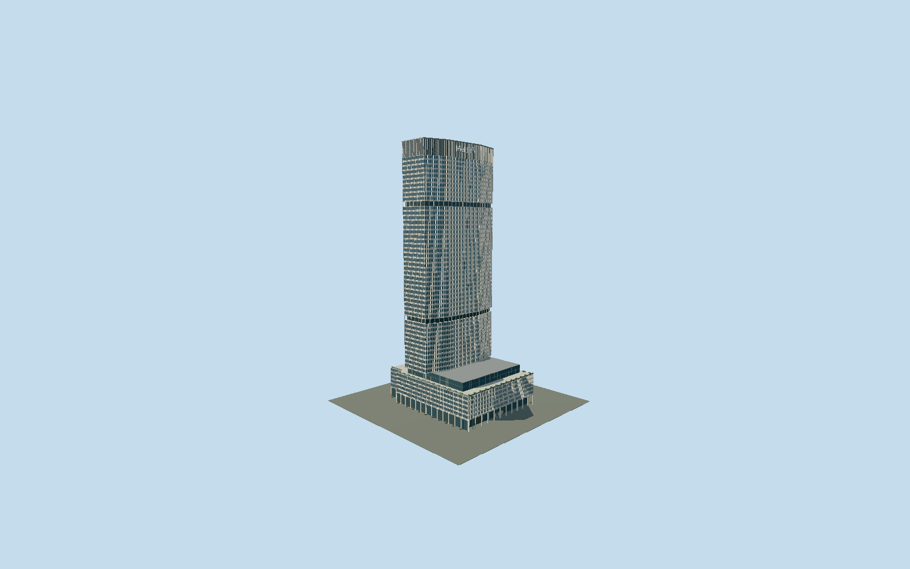

# MetLife Building

The broad octagonal 200 Park Avenue tower, with projecting quartz-aggregate precast window fins, two deeply recessed mechanical floors, roof lettering, aluminum-clad eighth/ninth floors and the renewed travertine north arcade.

## Evidence and reconstruction

Published dimensions and reconstructed details are separated in spec.json. Primary references:

- [Reference](https://www.hoffarch.com/project/metlife-building/)
- [Reference](https://usmodernist.org/AF/AF-1962-02.pdf)
- [Reference](https://www.irvinecompanyoffice.com/content/dam/office/3-readytopublish/portfolio/newyork/midtown/properties/200parkavenue/brochures/200ParkAvenue-Brochure.pdf)
- [Reference](https://www.mdeas.com/200park)
- [Reference](https://old.skyscraper.org/EXHIBITIONS/BIG_BUILDINGS/CONTENT/jumbos/j_02.htm)
- [Reference](https://awards-api.skyscrapercenter.com/building/metlife-building/909)
- [Reference](https://www.openstreetmap.org/way/137564641)

No third-party geometry, photograph or bitmap texture is embedded. Shared surface graphs come from the central library; vertex tints carry model colors. Glazing uses PBR materials; transparent surfaces are declared per model.

## Model and axes

30,667 triangles; 88,917 vertices; 4 material groups; 3,571,840 bytes. Native bounds: -57.102, 0.000, -46.975 to 57.102, 246.300, 46.976. Source hash: `sha256:2c0bbc6601eff8d6ad06210a87c69ad1de9c2300646d4eb5271ab807eedcb79a`.

{"up":"+Y","longitudinal":"+X north-northeast","front":"+X toward45thStreet entrance","origin":"Original mapped whole-building frame at reconstructed street grade"}

Fresh2026-10-10 OSM exact-Q464482 whole way137564642 and seven source-local map-parts retain the octagonal shaft137564641, broad30m podium1487962793, setback38m block137565295 and four separate columns1487962789–92. All seven part geometries match independent original map-parts; whole ring matches original independent georeferencing outline within3mm. Mapped entrance11507279903 near native[56.676,-.412] fixes the north frontage sign. Retain heading1.062997418385: +X north-northeast toward45thStreet, -X south-southwest toward GrandCentral, +Z east-southeast towardDepewPlace and -Z west-northwest towardVanderbilt. Common anchor[-73.976657641,40.753506014] remains; Y0 is reconstructed street entry. Mapped246m is rounded; published246.3m crown retained. Lower30/38m levels, two mechanical-recess heights and internal door offsets are reconstructions. Accept2m main-envelope/1degree allowance; no automatic footprint replacement. Separate GrandCentralTerminal and real terrain/adjacent street grades excluded.

## Reproduce

Run `node packages/worldgen/scripts/generate-signature-towers.mjs --ids=N0192` (or add `--check`). The generator preserves manually edited masters by checking their baseline hashes. Import through the standard authored-model workflow with optimization disabled; then capture all QA cameras, including shared-surface views.

## Pending work

- Original437075triangles/52320792byte per-cell detailed master remains exactly reproducible through unchanged buildMetlife recipe. Reviewed source merges repeating precast spandrels, vertical piers and triangular fins around continuous inset glazing instead of independent framed window boxes. It retains all original major facade floor datums, two genuinely recessed mechanical levels, separate support-column footprints, crown screen/fins and original polygonal north/south lettering, north arcade/soffit, three revolving doors and podium terrace. Fine cell seam gaps/transoms and per-cell glass tint variation are removed; all original detail remains available through unchanged master recipe. Skyline aggregates facade ribbons/piers and uses flat original letter faces, coarse arcade/door rings and shared graph colour means. District restores sampled vertical piers and dark recesses; street restores each facade datum/pier, continuous0.33m triangular shaft fins and extruded signage while flattening spandrel/pier return faces; close-up retains continuous triangular fins and finer entry/terrace grids. Concrete, travertine and coated-metal canonical graphs supply four near draw groups including one opaque glass group; no embedded images. Original door transparency becomes tinted opaque panels; no interior transparency/fit-out claim. Exact panel pitch, recess elevations, fin dimensions, signage outline and entrance/terrace details remain photo reconstructions. No surveyed grade or physical-device performance claim. Skyline omits revolving-door hardware, tiny fixtures and the outer mechanical-recess columns, retaining the inset dark belts and their floor/ceiling caps; only one pair of spandrels is sampled per shaft zone. Skyline arcade columns use a coarser spacing. Street strips use flat front faces; their triangular cast fins still have three actual side faces and both end caps. Far glazing sits2cm behind the facade strips instead of24.5cm, preventing coplanar overlap while approximating the facade depth. Per-level errors describe finite tested broad surfaces, excluding omitted slender columns/fins and entrance hardware, not a global Hausdorff bound.

This bundle follows the medium-fi standard. Medium-fi appearance and geographic fit are reviewed separately. Hash-bound visual acceptance is recorded separately after capture inspection.
