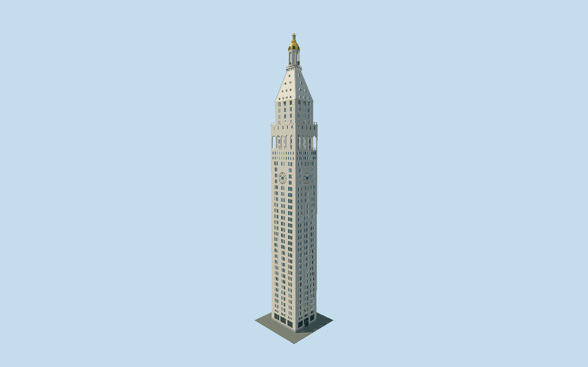

# Metropolitan Life Insurance Company Tower

The restored1909 campanile: subtly narrowing limestone/marble shaft with triple windows, four decorated mosaic clocks, five open arches on each gallery, dormered lattice pyramid, bronze bells, octagonal cupola and gilded lantern.

## Evidence and reconstruction

Published dimensions and reconstructed details are separated in spec.json. Primary references:

- [Reference](https://s-media.nyc.gov/agencies/lpc/lp/1530.pdf)
- [Reference](https://www.bcausa.com/portfolio?catid=19&id=162%3Aone-madison-avenue&view=article)
- [Reference](https://graciano.com/project/metlife-building/)
- [Reference](https://www.editionhotels.com/new-york/)
- [Reference](https://www.editionhotels.com/new-york/gallery/)
- [Reference](https://www.kpf.com/project/one-madison-avenue)
- [Reference](https://www.openstreetmap.org/way/158404390)

No third-party geometry, photograph or bitmap texture is embedded. Shared surface graphs come from the central library; vertex tints carry model colors. Glazing uses PBR materials; transparent surfaces are declared per model.

## Model and axes

61,202 triangles; 167,838 vertices; 4 material groups; 6,779,444 bytes. Native bounds: -13.312, 0.000, -11.837 to 13.417, 213.360, 11.837. Source hash: `sha256:80f34169cf069551e934fb26dcf3dbc871128302abdc9529a17b553e7bca7a2b`.

{"up":"+Y","front":"+X toward Madison Avenue","north":"+Z toward East24th Street"}

Fresh2026-10-10 exact-Q652452 tower way158404390 and eight independent original concentric crown parts retain the source-local anchor[-73.98735919999999,40.7412668] and heading2.6397482317108167. All nine raw geometries match the original independent map-frame exactly; projection matches the six-node native outline within1mm. +X points west-northwest toward MadisonAvenue and MadisonSquarePark; +Z points north-northeast along East24thStreet. LPC1530 street-labelled original block plan and restored elevations sign those axes, and its largest7000lb west bell corresponds to native+X,3000lb east bell to-X,2000lb north to+Z and1500lb south to-Z. Published85x75ft/25.908x22.86m base governs over mapped25.687x22.523m rectangle; half-width differences are0.11/0.17m. Rounded mapped tower-part heights150–213m do not replace the700ft/213.36m primary tip. Real street curb/grade, clock/crown floor elevations and the current hotel door dimensions are reconstructions. OriginalLPC1989 false East24thStreet doors are historical; the contemporary Madison-facing door is an unsurveyed hotel-era approximation, not a map-verified entrance. Accept1m principal-envelope/1degree placement allowance. Adjacent whole-block OneMadison office redevelopment way109280428 is excluded. No footprint replacement.

## Reproduce

Run `node packages/worldgen/scripts/generate-signature-towers.mjs --ids=N0193` (or add `--check`). The generator preserves manually edited masters by checking their baseline hashes. Import through the standard authored-model workflow with optimization disabled; then capture all QA cameras, including shared-surface views.

## Pending work

- The unchanged original buildMetropolitan recipe reproduces289882triangles/27024756bytes exactly. Reviewed source keeps the original narrowing85x75ft shaft, all major floor/window datums, four8.0772m dials, paired clock-level windows, genuinely open five-arch galleries around an inset windowed core, raised balustraded setbacks,34pyramidal roof dormers, octagonal cupola with four unequal bronze bells, eight dome dormers, upper platform, glazed lantern and213.36m tip. Source retains twelve Arabic numbers,60minute discs, original fixed10:10 hands, raised folded wreath leaves/fruit and stylized corner shell/dolphin scrolls. Clock strokes become flat ribbons; original0.068m raised roof lattice and thin gold dome seams fall below medium-fi extent thresholds and are omitted. Door/facade/grille/tiny ornament dimensions and all intermediate crown stage elevations remain original photo reconstructions; only overall base/height/dial dimensions and major counts are primary measurements. Skyline keeps four white/turquoise clocks and hands,20front-facing arched apertures, true inner core/setbacks and coarse open cupola, dome/lantern mass; it omits window subdivisions, gallery back faces/intrados, bell hardware, dormers and tiny guards. District groups each window triplet into one pane, samples six-floor datums, retains sparse arch intrados, flat arched dormer panes and fuller crown stages but omits bells and numerals. Street restores independent window/floor cadence, Arabic numerals, folded sampled wreath and all four bells with denser dormers/balustrades, omitting bronze numeral outline, minute discs and fruit. Close-up restores fine clock ornament, frames and crown sampling. Shared limestone approximates varied original marble/limestone; tinted painted-metal graph approximates bronze and gold-colored dome. All near levels use four draw groups with no embedded images. Real OneMadison office wing, street surroundings and interiors are excluded. Physical-device/dense-city timing and surveyed entrance/curb fit are not claimed.

This bundle follows the medium-fi standard. Medium-fi appearance and geographic fit are reviewed separately. Hash-bound visual acceptance is recorded separately after capture inspection.
