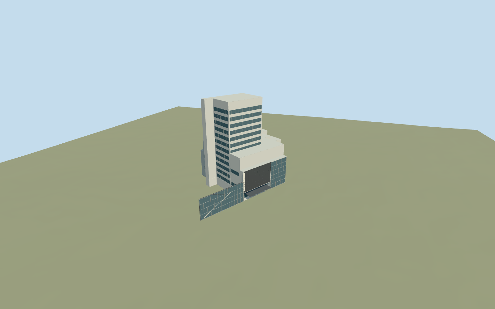

# Museum of Modern Art

Museum of Modern Art, New York: complete named mapped museum core and six integrated roof/body parts, with stepped white and grey gallery blocks, tall mapped west service block, dark 53rd Street facade and recessed glazed entry, thin projecting knife-edge canopy, pale vertical MoMA blade, garden-facing mullioned glazing/terrace and low western gallery-front cladding attached to the independently retained53W53 podium. Museum Tower/53W53 upper buildings, independent east brownstones, sculpture garden pools/trees/art and furnished interiors remain context.

## Evidence and reconstruction

Published dimensions and reconstructed details are separated in spec.json. Primary references:

- [Reference](https://commons.wikimedia.org/wiki/File:Museum_of_Modern_Art_(MoMA)_(51395759113).jpg)
- [Reference](https://commons.wikimedia.org/wiki/File:MOMAyard.JPG)

Museum of Modern Art, New York: complete named mapped museum core and six integrated roof/body parts, with stepped white and grey gallery blocks, tall mapped west service block, dark 53rd Street facade and recessed glazed entry, thin projecting knife-edge canopy, pale vertical MoMA blade, garden-facing mullioned glazing/terrace and low western gallery-front cladding attached to the independently retained53W53 podium. Museum Tower/53W53 upper buildings, independent east brownstones, sculpture garden pools/trees/art and furnished interiors remain context.

## Model and axes

8,560 triangles; 25,342 vertices; 6 material groups; 1,018,936 bytes. Native bounds: -79.792, -0.825, -43.500 to 54.646, 74.967, 33.060. Source hash: `sha256:512efbdc9374ea2da928c5497c6e07dadec0513fda38b7140335886994ba9f37`.

{"x":"east","y":"up","z":"south"}

The geographic proposal uses exact-QID OpenStreetMap evidence. Map-derived orientation and estimated architectural details require real-site visual review; preview eligibility is distinct from geographic/fidelity approval. Map attribution: © OpenStreetMap contributors, ODbL-1.0.

## Reproduce

Run `node packages/worldgen/scripts/generate-additional-landmarks.mjs --ids=N0747` (or add `--check`). The generator preserves manually edited masters by checking their baseline hashes. Import through the standard authored-model workflow with optimization disabled; then capture all QA cameras, including shared-surface views.

## Pending work

- Museum of Modern Art, New York: complete named mapped museum core and six integrated roof/body parts, with stepped white and grey gallery blocks, tall mapped west service block, dark 53rd Street facade and recessed glazed entry, thin projecting knife-edge canopy, pale vertical MoMA blade, garden-facing mullioned glazing/terrace and low western gallery-front cladding attached to the independently retained53W53 podium. Museum Tower/53W53 upper buildings, independent east brownstones, sculpture garden pools/trees/art and furnished interiors remain context.
- Q188740 and named MoMA OSM way278346578v43/native35184650435410. Five mapped25/35m gallery roof parts and relation2100751v5 member way148251196 supply integrated museum geometry. Keep independent Museum Tower ways148251193/194/195 and53W53 way261504062, plus every unrelated building. Internal+X follows53rd Street east-southeast; internal+Z points toward53rd Street/front sidewalk. World heading0 with this orientation baked into geometry; west facade skin is at the mapped53W53 street boundary, without removing that independent building.
- Unqualified mapped25/35m gallery heights and74.8m west service-block height retained as controls. Photograph-led7m entry recess,25m dark front slab,17m west gallery-front glazing and thin4.4m canopy. The74.8m control is retained rather than certified by the limited street/garden views; hidden facade/roof plant, floors and window inventory are reconstructions. Working floor19.4m absolute is fitted to the ordinary19m map elevation/standard DEM; threshold/accessibility not surveyed.
- Original standard Protomaps20261020 and Mapzen201x201/6m terrain remain unchanged. Uncovered front sidewalk provider internal[-20,34], datum19.332799049337236m. Occupied museum floor19.4m absolute seals the exact parent/part ground opening; footing reaches below original boundary grades. Ground beneath the entry canopy and western cladding remains original. No broad block slab, custom terrain or removal of adjacent towers. Current native street, garden, west-front and overhead views inspected. Main entrance floor sits0.067m above uncovered front-sidewalk datum; boundary footing exposure is modest on the retained grid. Recessed glazing and thin canopy fit without broad terrain edits. Independent Museum Tower/53W53 and all2918 resident neighbours remain intact. Approximate exterior fit accepted; exact thresholds/accessibility and unqualified mapped heights are not certified.

This bundle follows the medium-fi standard. Medium-fi appearance and geographic fit are reviewed separately. Hash-bound visual acceptance is recorded separately after capture inspection.
