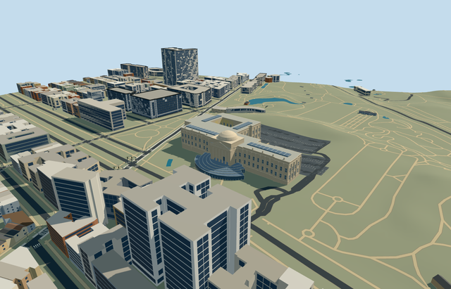

# N0766 — Brooklyn Museum

Reviewed 2026-10-23. **Completed medium-fi connected exterior; qualified approximate native fit.**

## Built and inspected

Connected Brooklyn Museum exterior: long pale stone wings and asymmetric rear ranges, six tapered Ionic columns with abstract volutes and real colonnade depth, supported triangular pediment/original geometric relief, square attic and shallow stone dome, repeated tall window proxies/pilasters/cornices and flat roof skylights. Five descending concentric glass-roof bands form the curved entrance pavilion with metal framing, a real 1.1m lower entrance recess/soffit/threshold and two short approach treads. The picture-led rear court stays open. Moved the frontal camera onto the plaza after procedural buildings across the street obscured it. Ordinary front photograph/aerial and standard PMTiles/Mapzen guided one continuous author/inspect/fix pass. Temporary banners, copied sculptures/inscriptions, terrace gardens/fountains and furnished rooms remain outside scope.

## Materials and LODs

Seven material roles share six existing 256px graphs: stone_limestone (wall/trim tint variants), plaster_lime (court), membrane, storefront (opaque window/glass-roof proxies), metal_painted and brick. Canonical metric UVs, sRGB-to-linear tint and baked graph means for skyline. Seven textured draws/one skyline; no embedded image, private atlas or new graph. Separate vertex streams and equal CPU/GPU accounting. Every used graph reads once, and unloading disposes all model geometry. Native grade-specific bases intersect flat review planes or expose patches; original native terrain supplies geographic fit.

| Level | Triangles | Bytes | Draws |
| --- | ---: | ---: | ---: |
| skyline | 826 | 75148 | 1 |
| district | 3622 | 337228 | 7 |
| street | 10126 | 903916 | 7 |
| closeup | 26486 | 2424296 | 7 |

Four authored LODs 826 / 3622 / 10126 / 26486 triangles; initial skyline+district geometry 412376 bytes, closeup 2424296 bytes. Six GLBs zero Khronos errors/warnings, 226 actual mesh/contact probes and five actual PMTiles13/14/15 cases, including two detailed owned records. Inspected52 current source/shared/medium-fi/native frames. Source individual window-frame/mullion geometry is reserved for closeup; street retains all window bays/pilasters and roof framing. Skyline simplifies the stepped pavilion roof to one glass cap while keeping the six-column portico, attic/dome and open rear court. Every LOD keeps both approach treads. Four LODs/failure/unload preserve1326 resident /1864 wider independent buildings, original201x201/6m terrain, roads and9087.535m² water. Failure keeps all1328 original resident buildings. Every run restores ground/water and leaves zero live model geometry. Default synthetic street context frames place the camera inside the rear court and clip a roof underside at the upper edge; custom front/detail frames and the current native exterior views cover the portico, pavilion, entrances, wings and open court.

## Geographic fit

Q632682 and named parent way1432069915/native35185804158747 identify Brooklyn Museum; integral main-body part way250229991/native35184622318823 is also owned. Only these two overlapping records are replaced. The mapped curved pavilion and connected wing outline supply meter scale. Origin is the midpoint of the historic portico front edge; internal +X follows the facade west-northwest and +Z points north-northeast toward Eastern Parkway. Native east/up/south axes are baked with heading 0. The rear court is visible in the ordinary aerial but not opened in this map polygon: its 35x25m rectangle is an explicit picture-led approximation, kept open in geometry and terrain. Qualified approximate native exterior fit on original Protomaps20261020/Mapzen 201x201 / 6m ground. Open front provider[0,36] supplies 48.12656157087435m datum. Boundary grades -3.336..+1.678m, floor +0.2m and closed foundation -3.516m. Native views show supported museum/pavilion with low-side plinth exposure and uphill base burial; the rear court and outer approaches retain original ground. Two short reconstructed 0.18m treads bridge the roughly0.4m lower-door threshold above approach ground -0.132m. Exact pavilion/terrace grades, archaeological/historic court paving, thresholds and accessibility remain unverified. No bespoke terrain or flattening.

## Fidelity and limits

Medium-fi picture-led exterior. The single unqualified 50m map height is not used as a surveyed measurement. Working main roof 26m, upper portico floor 5.1m, six tapered Ionic columns to22.8m, pediment peak30m, square attic31.2m and shallow stone dome to39m above floor. Pavilion uses five descending concentric glass-roof bands approximately6.4..4.4m above floor. Rear court dimensions/placement, heights, bay counts, hidden faces, roof equipment, statue/relief abstractions and roof junctions are approximate. Two current ordinary pictures establish main colors/silhouette; no exhibition banners, copied artworks, furnished galleries or costly transparent/refraction materials. The two reconstructed 0.18m exterior treads are a working fit to the original standard approach, not surveyed historic steps. Qualified approximate native exterior fit on original Protomaps20261020/Mapzen 201x201 / 6m ground. Open front provider[0,36] supplies 48.12656157087435m datum. Boundary grades -3.336..+1.678m, floor +0.2m and closed foundation -3.516m. Native views show supported museum/pavilion with low-side plinth exposure and uphill base burial; the rear court and outer approaches retain original ground. Two short reconstructed 0.18m treads bridge the roughly0.4m lower-door threshold above approach ground -0.132m. Exact pavilion/terrace grades, archaeological/historic court paving, thresholds and accessibility remain unverified. No bespoke terrain or flattening. Meets the medium-fi connected-exterior standard. The 35x25m rear court is an explicit picture-led approximation absent from the filled source polygon, rather than a mapped hole. Sculpture/relief ornaments are original schematic blocks/lofts, not copied figures. Glazing/skylights are opaque exterior proxies; no furnished galleries, art/text copies, costly refraction or bespoke ground. Physical phone/laptop and dense-city timings remain pending.

## Targeted checks

Selected generation/import/placement, strict medium-fi, scene/sim30 and two-recipe lint pass. Sim30 sha256:ce93ed8ba35e60d541828781095d72196bca66a038bd6e5675f0895959fe97d9. Current pins in [qa.json](qa.json); source controls in [map-frame.json](map-frame.json).

## References

- https://commons.wikimedia.org/wiki/File:Brooklyn_Museum_-_Entrance_(52302265063).jpg — Ajay Suresh (ajay_suresh); 2022-06-20; CC-BY-2.0; viewed only, no copied pixels. Viewed only; no copied pixels.

- https://www.timeout.com/newyork/news/the-brooklyn-museum-will-celebrate-its-200th-birthday-this-year-020124 — Audley C Bullock / Shutterstock, credited by Time Out; Photo date unspecified; article2024-02-01; No reuse license established; viewed only, no copied pixels. Viewed only; no copied pixels.

- https://www.openstreetmap.org/way/1432069915 and https://www.openstreetmap.org/way/250229991 — named parent and integral body part; ©OpenStreetMap contributors, ODbL-1.0.

## Completion checklist

- [x] Rebuildable master/import, four authored LODs and six existing shared textures.
- [x] Current geometry/material/medium-fi/native frames inspected; source/runtime/input hashes current.
- [x] Two controlled map records, baked orientation and explicit picture-led court approximation.
- [x] Qualified original-terrain fit, recessed lower entrance/closed treads, retained court/approaches.
- [x] Independent buildings/roads/water preserved; failure fallback and clean unload checked.
